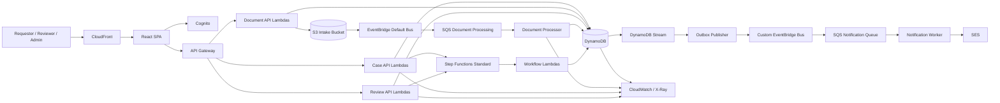
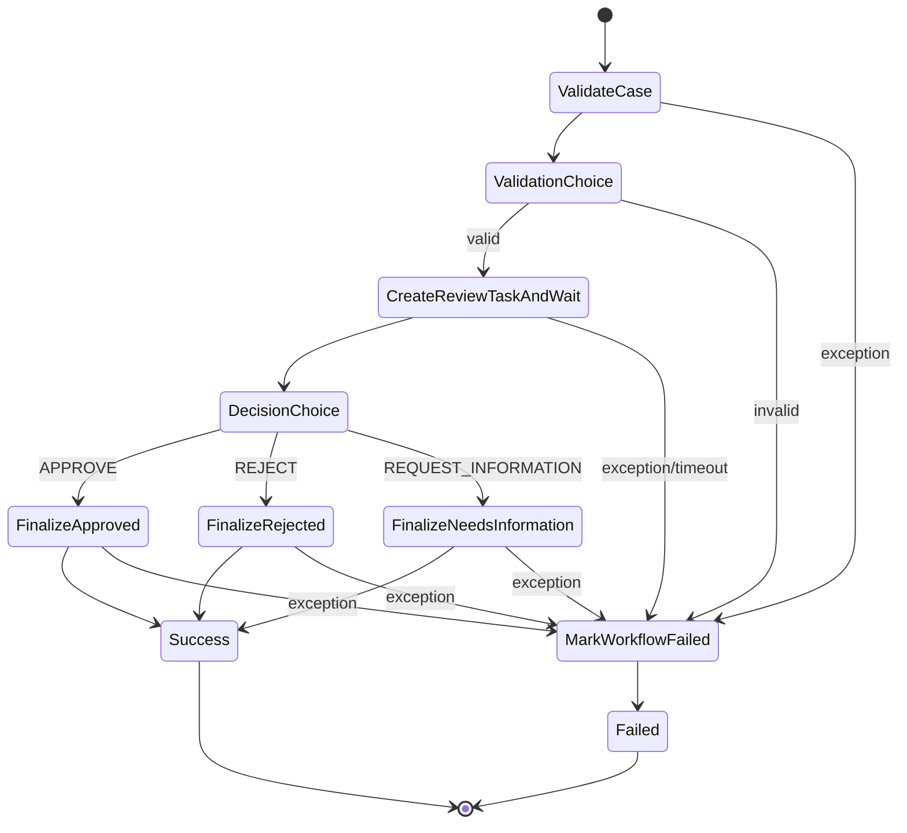

# DocFlow — TECHNICAL_DESIGN.md

**Version:** 1.1  
**Status:** Implementation baseline  
**Related PRD:** PRD v1.1  
**Architecture Style:** Serverless + Event-driven + Human-in-the-loop  
**IaC:** Terraform  
**Primary Language Recommendation:** Python 3.13 for Lambda, TypeScript/React for frontend

Current evidence/deployment note (ADR-029, 2026-09-29): this is a design baseline,
not a statement that every depicted component is deployed. The current frontend
is a separate synthetic preview without Cognito/API integration. The owner skipped
remaining TASK-021 acceptance and requested AWS retirement. See the
[portfolio architecture](portfolio/architecture.md) for implemented topology and
[retirement evidence](verification/AWS-RETIREMENT.md) for current resource outcomes.

---

# 1. Purpose

This document freezes the technical baseline for DocFlow before implementation.

The goal is to prevent implementation tools or contributors from changing the architecture opportunistically while coding.

Changes to the following require an explicit Architecture Decision Record (ADR):

- domain states
- DynamoDB key model
- public API contracts
- event envelope
- queue topology
- Step Functions lifecycle
- authentication/authorization model
- infrastructure module boundaries

---

# 2. Design Principles

1. **Serverless-first**
2. **Domain state before integration**
3. **Asynchronous where work can fail/retry independently**
4. **Synchronous where the caller needs immediate validation**
5. **Step Functions orchestrates a Case; EventBridge broadcasts domain facts**
6. **DynamoDB conditional writes protect concurrency**
7. **SQS consumers are idempotent**
8. **Domain events are published via transactional outbox**
9. **Human review is a first-class state, not an exception path**
10. **Project 1 must remain AI-free**
11. **No WebSocket in MVP**
12. **Malware scanning is a hardening phase, but the data model leaves room for it**

---

# 3. System Context



---

# 4. AWS Resource Inventory

MVP resources:

## Edge / Frontend

- CloudFront distribution
- S3 frontend bucket
- optional Route 53 custom domain later

## Identity

- Cognito User Pool
- Cognito App Client
- Groups:
  - `requester`
  - `reviewer`
  - `admin`

## API

- API Gateway HTTP API
- JWT Authorizer

## Compute

Lambda functions defined in Section 8.

## Data

- DynamoDB table: `docflow`
- DynamoDB Stream enabled: `NEW_AND_OLD_IMAGES`
- S3 bucket: `docflow-documents`
- optional S3 quarantine prefix for future malware scanning

## Messaging

- custom EventBridge bus: `docflow-domain`
- SQS:
  - `document-processing-queue`
  - `document-processing-dlq`
  - `notification-queue`
  - `notification-dlq`

## Workflow

- Step Functions Standard state machine:
  - `docflow-case-review-workflow`

## Notifications

- SES identity/configuration

## Observability

- CloudWatch log groups
- custom metrics
- alarms
- X-Ray active tracing

---

# 5. Environment Strategy

Use three logical environments eventually:

- `dev`
- `staging`
- `prod`

For initial implementation, only `dev` is required.

Naming convention:

```text
docflow-{env}-{resource}
```

Examples:

```text
docflow-dev-api
docflow-dev-documents
docflow-dev-domain
docflow-dev-document-processing
```

Terraform state should be separated by environment. TASK-002 starts with an explicit
local backend in `infra/environments/dev`; remote bootstrap and migration must precede
shared or automated deployment. See ADR-005 and section 18.1.

---

# 6. DynamoDB Design

## 6.1 Table

Table name:

```text
docflow-{env}
```

Primary key:

```text
PK  String
SK  String
```

GSIs:

```text
GSI1PK String
GSI1SK String

GSI2PK String
GSI2SK String
```

TTL attribute:

```text
expiresAtEpoch
```

DynamoDB Stream:

```text
NEW_AND_OLD_IMAGES
```

TASK-002 physical configuration uses PAY_PER_REQUEST billing, indexes named `GSI1`
and `GSI2` with ALL projections, PITR enabled and deletion protection enabled by default.
Default AWS-owned encryption protects the table and indexes. Only the six key attributes
are declared in Terraform; item attributes remain schemaless. These settings preserve all
PK/SK and access patterns below. Future query APIs must continue filtering internal fields.

---

## 6.2 Entity access patterns

Required access patterns:

1. Get one Case.
2. Get a Case with Documents and Review Tasks.
3. List Cases created by a Requester.
4. List Cases by status for Admin.
5. Get one Document.
6. List Review Tasks for a Reviewer.
7. List unassigned Review Tasks.
8. Get audit timeline for a Case.
9. Load a Checklist Template version.
10. Find pending Outbox records through stream events.
11. Check idempotency keys for asynchronous consumers.

---

## 6.3 Case item

```text
PK = CASE#{caseId}
SK = CASE
```

Example:

```json
{
  "PK": "CASE#c_01J...",
  "SK": "CASE",
  "entityType": "CASE",
  "caseId": "c_01J...",
  "caseType": "SUPPLIER_ONBOARDING",
  "requesterId": "user-123",
  "status": "DRAFT",
  "checklistTemplateId": "supplier-onboarding",
  "checklistTemplateVersion": 1,
  "submissionAttempt": 0,
  "version": 1,
  "createdAt": "2026-09-09T02:00:00Z",
  "updatedAt": "2026-09-09T02:00:00Z",

  "GSI1PK": "REQUESTER#user-123",
  "GSI1SK": "CASE#2026-09-09T02:00:00Z#c_01J...",

  "GSI2PK": "CASE_STATUS#DRAFT",
  "GSI2SK": "UPDATED#2026-09-09T02:00:00Z#c_01J..."
}
```

`version` is used for optimistic concurrency when required.

When Case status changes, `GSI2PK` must be updated transactionally.

---

## 6.4 Document item

```text
PK = CASE#{caseId}
SK = DOC#{documentId}
```

Example:

```json
{
  "PK": "CASE#c_01J...",
  "SK": "DOC#d_01J...",
  "entityType": "DOCUMENT",
  "documentId": "d_01J...",
  "caseId": "c_01J...",
  "documentType": "COMPANY_REGISTRATION",
  "fileName": "registration.pdf",
  "fileSize": 183829,
  "mimeType": "application/pdf",
  "s3Key": "cases/c_01J.../documents/d_01J.../v1/source",
  "status": "UPLOADING",
  "validationStatus": "PENDING",
  "scanStatus": "NOT_IMPLEMENTED",
  "documentVersion": 1,
  "createdAt": "2026-09-09T02:05:00Z",
  "updatedAt": "2026-09-09T02:05:00Z"
}
```

Do not use user-provided filename as the S3 key.

---

## 6.5 Review Task item

```text
PK = CASE#{caseId}
SK = TASK#{taskId}
```

Example:

```json
{
  "PK": "CASE#c_01J...",
  "SK": "TASK#t_01J...",
  "entityType": "REVIEW_TASK",
  "taskId": "t_01J...",
  "caseId": "c_01J...",
  "attempt": 1,
  "status": "PENDING",
  "reviewerId": null,
  "priority": "NORMAL",
  "dueAt": "2026-09-11T02:20:00Z",
  "workflowExecutionArn": "arn:aws:states:...",
  "workflowTaskToken": "<server-only-value>",
  "decision": null,
  "createdAt": "2026-09-09T02:20:00Z",

  "GSI1PK": "REVIEWER#UNASSIGNED",
  "GSI1SK": "TASK#PENDING#DUE#2026-09-11T02:20:00Z#t_01J..."
}
```

The API must never return `workflowTaskToken`.

When claimed:

```text
GSI1PK = REVIEWER#{reviewerId}
```

This move is performed with a conditional update.

---

## 6.6 Checklist result items

Template definitions are immutable; reviewer findings are stored per task.

```text
PK = CASE#{caseId}
SK = CHECK#{taskId}#{checkId}
```

Example:

```json
{
  "entityType": "CHECK_RESULT",
  "taskId": "t_01J...",
  "checkId": "company-registration-readable",
  "result": "PASS",
  "comment": null,
  "updatedBy": "reviewer-123",
  "updatedAt": "..."
}
```

Allowed result values:

- `NOT_REVIEWED`
- `PASS`
- `FAIL`
- `NOT_APPLICABLE`

---

## 6.7 Audit items

```text
PK = CASE#{caseId}
SK = AUDIT#{timestamp}#{auditId}
```

Example:

```json
{
  "entityType": "AUDIT",
  "auditId": "a_01J...",
  "caseId": "c_01J...",
  "actorId": "reviewer-123",
  "actorType": "USER",
  "action": "REVIEW_STARTED",
  "resourceType": "REVIEW_TASK",
  "resourceId": "t_01J...",
  "previousState": "CLAIMED",
  "newState": "IN_PROGRESS",
  "correlationId": "corr-...",
  "timestamp": "..."
}
```

Audit items are append-only.

---

## 6.8 Outbox items

Every business transaction that must emit a domain event writes an Outbox item in the same DynamoDB transaction.

```text
PK = CASE#{caseId}
SK = OUTBOX#{eventId}
```

Example:

```json
{
  "entityType": "OUTBOX",
  "eventId": "evt_01J...",
  "eventType": "CaseSubmitted",
  "eventVersion": "1.0",
  "source": "docflow.case",
  "correlationId": "corr-...",
  "caseId": "c_01J...",
  "status": "PENDING",
  "detail": {
    "caseId": "c_01J...",
    "attempt": 1
  },
  "createdAt": "..."
}
```

Outbox rows have no TTL in the current implementation; never expire PENDING facts.
The Outbox Publisher listens to DynamoDB Streams.

After a successful EventBridge `PutEvents`, it updates:

```text
status = DISPATCHED
dispatchedAt = ...
```

Stream filter criteria should invoke the publisher only when:

```text
entityType == OUTBOX
AND status == PENDING
```

This avoids recursive invocation after the item becomes `DISPATCHED`.

---

## 6.9 Idempotency items

For SQS/event consumers:

```text
PK = IDEMPOTENCY#{consumerName}
SK = EVENT#{eventId}
```

Attributes:

```json
{
  "status": "COMPLETED",
  "processedAt": "...",
  "expiresAtEpoch": 1780000000
}
```

The consumer first conditionally inserts the key.

Only an existing COMPLETED claim is acknowledged as a duplicate. IN_PROGRESS claims
require retry while leased, or conditional takeover after expiry. TASK-010 uses a
120-second owner lease and atomically completes the claim with state/audit/outbox;
see ADR-013. An unfinished claim must never cause successful acknowledgement.

For S3-created events, use a deterministic idempotency key based on:

```text
bucket + objectKey + versionId/eTag
```

---

## 6.10 Checklist Template items

Template metadata:

```text
PK = TEMPLATE#{templateId}
SK = VERSION#{version}
```

Example:

```json
{
  "entityType": "CHECKLIST_TEMPLATE",
  "templateId": "supplier-onboarding",
  "version": 1,
  "caseType": "SUPPLIER_ONBOARDING",
  "status": "ACTIVE",
  "requiredDocuments": [
    "COMPANY_REGISTRATION",
    "DIRECTOR_ID",
    "BANK_INFORMATION",
    "ADDRESS_PROOF"
  ],
  "createdAt": "..."
}
```

Check definitions:

```text
PK = TEMPLATE#{templateId}
SK = VERSION#{version}#CHECK#{order}#{checkId}
```

This keeps previous Case behavior stable when the template later changes.

### TASK-004 persistence rules (ADR-008)

The immutable metadata/check key formats above are unchanged. The initial case-type
mapping is SUPPLIER_ONBOARDING -> supplier-onboarding. Active resolution performs a
strongly consistent paginated Query of that template partition and selects the
highest numeric ACTIVE metadata version. ACTIVE means published/eligible; older
published versions remain immutable and loadable. New publication selects the new
maximum for future Cases only. No draft/retirement/rollback API is implemented.

Checks carry checkId, numeric order, documentType, required and reviewer instructions.
Metadata adds checkCount and canonical contentHash for completeness/integrity checks.
The first seed has four required document checks and one optional registration note.

Publish metadata, 1-98 checks and one audit in an all-or-nothing conditional transaction.
No existing item may be overwritten. Identical replay does no writes; changed content
for the same version fails. Incomplete data fails rather than being silently repaired.
Template audits extend the template partition with SK AUDIT#{timestamp}#{auditId},
including actor, action TEMPLATE_VERSION_PUBLISHED, version, timestamp and content hash.
Existing CASE audit PK/SK and all GSI formats are unchanged. No template domain event
is required by the current event contract; do not invent one for configuration seeding.

Use strongly consistent GetItem for exact metadata and paginated prefix Query for
checks, sorted numerically. Case creation in TASK-005 must persist templateId/version.
The operator CLI defaults to preview and permits writes only to a loopback endpoint;
real AWS seed/permissions/transaction evidence remains deferred to TASK-021.


---

# 7. S3 Design

Bucket:

```text
docflow-{env}-documents
```

Block Public Access:

```text
enabled
```

Encryption:

```text
SSE-S3 for MVP
SSE-KMS optional hardening
```

Object key:

```text
cases/{caseId}/documents/{documentId}/v{version}/source
```

Future quarantine:

```text
quarantine/{caseId}/{documentId}/...
```

Presigned URL expiry:

```text
10 minutes
```

Recommended upload constraints:

- PDF: max 15 MB
- JPG/PNG: max 10 MB
- allowed MIME list configurable per template/system config

The backend creates the Document record **before** issuing the presigned URL.

S3 Object Created events are enabled for EventBridge.

---

# 8. Lambda Functions

The MVP uses bounded-context Lambdas instead of one Lambda per endpoint.

## 8.1 `case-command-handler`

Triggered by API Gateway.

Routes:

- `POST /cases`
- `POST /cases/{caseId}/submit`
- `POST /cases/{caseId}/resubmit`

Responsibilities:

### Create

- validate role
- resolve active Checklist Template
- generate caseId
- transact:
  - Case item
  - Audit item
  - Outbox `CaseCreated`

### Submit/Resubmit

- verify ownership
- load required documents
- ensure all required docs are VALID
- ensure Case state is allowed
- increment attempt
- transact:
  - Case status = SUBMITTED
  - Audit
  - Outbox `CaseSubmitted` or `CaseResubmitted`
- call `StartExecution`
- store execution ARN with conditional update

Idempotency:

Support `Idempotency-Key` header for Submit/Resubmit.

---

## 8.2 `case-query-handler`

Routes:

- `GET /cases`
- `GET /cases/{caseId}`
- `GET /cases/{caseId}/activity`

Responsibilities:

- requester-owned list via GSI1
- admin list by status via GSI2
- aggregate Case + Documents + Tasks
- remove internal attributes
- paginate using opaque cursor

Never return:

- workflow task tokens
- internal outbox records
- idempotency records

---

## 8.3 `document-command-handler`

Routes:

- `POST /cases/{caseId}/documents/upload-url`
- `DELETE /cases/{caseId}/documents/{documentId}`

Upload URL responsibilities:

- validate ownership
- validate Case state (`DRAFT` or `NEEDS_INFORMATION`)
- validate documentType allowed by template
- generate documentId and backend-controlled S3 key
- create Document with `UPLOADING`
- return presigned URL

Delete responsibilities:

- allow only mutable Case states
- soft-delete Document metadata first
- optionally delete S3 object asynchronously
- write audit/outbox if business-relevant

---

## 8.4 `document-processor`

Trigger:

```text
SQS document-processing-queue
```

Source events originate from S3 Object Created via EventBridge default bus.

Responsibilities:

1. parse S3 event
2. derive idempotency key
3. conditionally claim processing
4. load Document metadata
5. verify expected bucket/key
6. HEAD object
7. set Document `VALIDATING`
8. validate:
   - size
   - MIME
   - extension consistency
   - required metadata
9. calculate/store SHA-256 when practical
10. set:
   - `VALID`
   - or `INVALID`
11. transact:
   - Document state
   - Audit
   - Outbox `DocumentValidated` or `DocumentValidationFailed`
12. mark idempotency completed

Failure behavior:

- raise exception
- SQS retries
- after max receives -> DLQ

Lambda batch size recommendation:

```text
5
```

Use partial batch response.

---

## 8.5 `outbox-publisher`

Trigger:

```text
DynamoDB Stream filtered OUTBOX/PENDING records
```

Responsibilities:

- map Outbox record into EventBridge event
- call PutEvents on custom bus
- update Outbox `DISPATCHED`
- log eventId/correlationId

Must tolerate duplicate stream delivery.

---

## 8.6 `workflow-validate-case`

Trigger:

Step Functions.

Responsibilities:

- defensive revalidation
- verify Case state/attempt
- verify required documents still valid
- return normalized workflow payload

Input:

```json
{
  "caseId": "c_...",
  "attempt": 1,
  "correlationId": "corr-..."
}
```

Output:

```json
{
  "caseId": "c_...",
  "attempt": 1,
  "valid": true,
  "checklistTemplateId": "supplier-onboarding",
  "checklistTemplateVersion": 1
}
```

---

## 8.7 `workflow-create-review-task`

Trigger:

Step Functions callback integration:

```text
lambda:invoke.waitForTaskToken
```

Responsibilities:

- create taskId
- calculate dueAt
- store task token server-side
- create checklist result skeletons
- transact:
  - Review Task
  - Case status -> REVIEW_PENDING
  - Audit
  - Outbox `CaseReadyForReview`
- return from Lambda while Step Functions remains waiting for callback

The task token is never returned to the browser.

---

## 8.8 `review-command-handler`

Routes:

- `POST /reviews/{taskId}/claim`
- `POST /reviews/{taskId}/start`
- `PUT /reviews/{taskId}/checks/{checkId}`
- `POST /reviews/{taskId}/decision`

### Claim

Conditional update:

```text
status == PENDING
AND reviewerId is NULL or does not exist
```

Update:

```text
status = CLAIMED
reviewerId = current reviewer
GSI1PK = REVIEWER#{reviewerId}
```

This prevents double-claim races.

### Start

Condition:

```text
reviewerId == current reviewer
AND status IN (CLAIMED)
```

Transaction:

- task -> IN_PROGRESS
- case -> IN_REVIEW
- audit
- outbox `ReviewStarted`

### Checklist update

Condition:

- current reviewer owns task
- task status = IN_PROGRESS

### Decision

Allowed decisions:

- APPROVE
- REJECT
- REQUEST_INFORMATION

Validation:

- task owned by caller
- task active
- all required checklist checks completed
- reason required for REJECT and REQUEST_INFORMATION (ADR-020)
- structured requested items required for REQUEST_INFORMATION

Persistence/callback algorithm:

1. conditionally update task with decision and `callbackStatus=PENDING`
2. write Audit
3. call Step Functions `SendTaskSuccess` with:
   ```json
   {
     "decision": "APPROVE",
     "decisionReason": null,
     "requestedItems": []
   }
   ```
4. mark `callbackStatus=DELIVERED`

If callback fails after state persistence, a retry of the same API request must attempt callback delivery again rather than creating a second decision.

---

## 8.9 `review-query-handler`

Routes:

- `GET /reviews`
- `GET /reviews/{taskId}`

Queries:

- unassigned: `GSI1PK = REVIEWER#UNASSIGNED`
- mine: `GSI1PK = REVIEWER#{userId}`

Returns:

- task
- Case summary
- documents
- checklist results

Removes:

- workflow task token
- internal callback metadata

---

## 8.10 `workflow-finalize-case`

Trigger:

Step Functions after human callback.

Input includes decision.

Responsibilities:

### APPROVE

Transaction:

- Case -> APPROVED
- decision metadata
- audit
- outbox `CaseApproved`

### REJECT

Transaction:

- Case -> REJECTED
- audit
- outbox `CaseRejected`

### REQUEST_INFORMATION

Transaction:

- Case -> NEEDS_INFORMATION
- store structured request summary
- audit
- outbox `AdditionalInformationRequested`

The completed Review Task remains immutable.

---

## 8.11 `workflow-failure-handler`

Trigger:

Step Functions Catch path.

Responsibilities:

- set workflow failure metadata
- keep business state recoverable
- write audit
- outbox `CaseWorkflowFailed`

Do not automatically reject a Case because of a technical failure.

---

## 8.12 `notification-worker`

Trigger:

```text
SQS notification-queue
```

Responsibilities:

- consume notification commands/events
- derive template
- send SES email
- write structured logs
- idempotency by eventId

MVP notification types:

- `CaseReadyForReview`
- `AdditionalInformationRequested`
- `CaseApproved`
- `CaseRejected`

---

## 8.13 Future Lambdas

Post-MVP:

- `sla-sweeper`
- `malware-result-handler`
- `websocket-connection-handler`
- `realtime-status-publisher`
- `admin-redrive-handler`

They are explicitly excluded from the first implementation sequence.

---

# 9. Event Model

## 9.1 Event buses

### EventBridge default bus

Used only for AWS service-originated events needed by DocFlow.

MVP use:

- S3 Object Created

### Custom bus

Name:

```text
docflow-{env}-domain
```

Used only for DocFlow domain events.

Do not mix raw AWS S3 events into the domain bus.

---

## 9.2 Domain event envelope

EventBridge fields:

```json
{
  "Source": "docflow.case",
  "DetailType": "CaseApproved",
  "EventBusName": "docflow-dev-domain",
  "Detail": "{...}"
}
```

Detail:

```json
{
  "eventId": "evt_...",
  "eventVersion": "1.0",
  "occurredAt": "2026-09-09T03:00:00Z",
  "correlationId": "corr_...",
  "caseId": "c_...",
  "actor": {
    "type": "USER",
    "id": "reviewer-123"
  },
  "data": {}
}
```

---

## 9.3 Event types

### Case domain

- `CaseCreated`
- `CaseSubmitted`
- `CaseResubmitted`
- `CaseReadyForReview`
- `CaseApproved`
- `CaseRejected`
- `AdditionalInformationRequested`
- `CaseWorkflowFailed`

Source:

```text
docflow.case
```

### Document domain

- `DocumentValidated`
- `DocumentValidationFailed`

Source:

```text
docflow.document
```

### Review domain

- `ReviewStarted`

Source:

```text
docflow.review
```

Future:

- `SLAExceeded`

---

# 10. EventBridge Rules

## Rule 1 — S3 object created → document queue

Bus:

```text
default
```

Event pattern conceptually:

```json
{
  "source": ["aws.s3"],
  "detail-type": ["Object Created"],
  "detail": {
    "bucket": {
      "name": ["docflow-dev-documents"]
    },
    "object": {
      "key": [{
        "prefix": "cases/"
      }]
    }
  }
}
```

Target:

```text
document-processing-queue
```

DLQ is configured on the SQS queue, not as an EventBridge target DLQ for normal processing failures.

---

## Rule 2 — CaseReadyForReview → notification queue

Bus:

```text
docflow-domain
```

Pattern:

```json
{
  "source": ["docflow.case"],
  "detail-type": ["CaseReadyForReview"]
}
```

Target:

```text
notification-queue
```

---

## Rule 3 — requester decision events → notification queue

Pattern:

```json
{
  "source": ["docflow.case"],
  "detail-type": [
    "AdditionalInformationRequested",
    "CaseApproved",
    "CaseRejected"
  ]
}
```

Target:

```text
notification-queue
```

---

## Rule 4 — workflow failure → notification/ops queue

MVP may route only to CloudWatch Alarm/SNS later.

Pattern:

```json
{
  "source": ["docflow.case"],
  "detail-type": ["CaseWorkflowFailed"]
}
```

Target:

- optional notification queue for admin email

---

# 11. SQS / DLQ Design

## 11.1 Document processing queue

Name:

```text
docflow-{env}-document-processing
```

DLQ:

```text
docflow-{env}-document-processing-dlq
```

Recommended settings:

```text
VisibilityTimeout = 6 x document processor Lambda timeout
ReceiveMessageWaitTimeSeconds = 20
maxReceiveCount = 5
```

Lambda timeout recommendation:

```text
60 seconds initially
```

Thus visibility timeout:

```text
360 seconds
```

Retention:

```text
main queue: 4 days
DLQ: 14 days
```

Partial batch response enabled.

---

## 11.2 Notification queue

Name:

```text
docflow-{env}-notification
```

DLQ:

```text
docflow-{env}-notification-dlq
```

Recommended:

```text
maxReceiveCount = 5
retention = 4 days
DLQ retention = 14 days
```

Notification is asynchronous and must not block Case state transitions.

---

# 12. Step Functions Design

State machine:

```text
docflow-{env}-case-review-workflow
```

Type:

```text
STANDARD
```

Reason:

Human review may wait hours or days. Standard workflows support long-lived durable executions and callback tasks.

---

## 12.1 Workflow input

```json
{
  "caseId": "c_...",
  "attempt": 1,
  "correlationId": "corr_...",
  "triggeredBy": "user-123"
}
```

---

## 12.2 State machine



---

## 12.3 ASL conceptual structure

```json
{
  "StartAt": "ValidateCase",
  "States": {
    "ValidateCase": {
      "Type": "Task",
      "Resource": "arn:aws:states:::lambda:invoke",
      "Next": "ValidationChoice",
      "Catch": [
        {
          "ErrorEquals": ["States.ALL"],
          "Next": "MarkWorkflowFailed"
        }
      ]
    },
    "ValidationChoice": {
      "Type": "Choice",
      "Choices": [
        {
          "Variable": "$.valid",
          "BooleanEquals": true,
          "Next": "CreateReviewTaskAndWait"
        }
      ],
      "Default": "MarkWorkflowFailed"
    },
    "CreateReviewTaskAndWait": {
      "Type": "Task",
      "Resource": "arn:aws:states:::lambda:invoke.waitForTaskToken",
      "TimeoutSeconds": 1209600,
      "Next": "DecisionChoice",
      "Catch": [
        {
          "ErrorEquals": ["States.ALL"],
          "Next": "MarkWorkflowFailed"
        }
      ]
    },
    "DecisionChoice": {
      "Type": "Choice",
      "Choices": [
        {
          "Variable": "$.decision",
          "StringEquals": "APPROVE",
          "Next": "FinalizeApproved"
        },
        {
          "Variable": "$.decision",
          "StringEquals": "REJECT",
          "Next": "FinalizeRejected"
        },
        {
          "Variable": "$.decision",
          "StringEquals": "REQUEST_INFORMATION",
          "Next": "FinalizeNeedsInformation"
        }
      ],
      "Default": "MarkWorkflowFailed"
    },
    "FinalizeApproved": {
      "Type": "Task",
      "Resource": "arn:aws:states:::lambda:invoke",
      "Next": "Success"
    },
    "FinalizeRejected": {
      "Type": "Task",
      "Resource": "arn:aws:states:::lambda:invoke",
      "Next": "Success"
    },
    "FinalizeNeedsInformation": {
      "Type": "Task",
      "Resource": "arn:aws:states:::lambda:invoke",
      "Next": "Success"
    },
    "MarkWorkflowFailed": {
      "Type": "Task",
      "Resource": "arn:aws:states:::lambda:invoke",
      "Next": "Failed"
    },
    "Success": {
      "Type": "Succeed"
    },
    "Failed": {
      "Type": "Fail"
    }
  }
}
```

`TimeoutSeconds` on the human callback is 14 days for MVP. SLA may be shorter; timeout is a technical ceiling, not business SLA.

---

# 13. API Design

Base path:

```text
/api/v1
```

All authenticated requests include:

```http
Authorization: Bearer <JWT>
X-Correlation-Id: <optional client value>
```

If absent, backend generates a correlation ID.

State-changing retry-sensitive operations may include:

```http
Idempotency-Key: <uuid>
```

Response error envelope:

```json
{
  "error": {
    "code": "CASE_INVALID_STATE",
    "message": "Case cannot be submitted from the current state.",
    "correlationId": "corr_..."
  }
}
```

---

## 13.1 Create Case

```http
POST /api/v1/cases
```

Request:

```json
{
  "caseType": "SUPPLIER_ONBOARDING"
}
```

Response `201`:

```json
{
  "caseId": "c_...",
  "caseType": "SUPPLIER_ONBOARDING",
  "status": "DRAFT",
  "checklistTemplate": {
    "id": "supplier-onboarding",
    "version": 1
  },
  "createdAt": "..."
}
```

Errors:

- `400 CASE_TYPE_INVALID`
- `401 UNAUTHORIZED`
- `403 FORBIDDEN`

---

## 13.2 List Cases

```http
GET /api/v1/cases?status=DRAFT&limit=20&cursor=...
```

Requester sees own Cases.

Admin may use:

```http
GET /api/v1/cases?owner=all&status=REVIEW_PENDING
```

Response:

```json
{
  "items": [],
  "nextCursor": null
}
```

---

## 13.3 Get Case

```http
GET /api/v1/cases/{caseId}
```

Response:

```json
{
  "case": {},
  "documents": [],
  "review": {
    "currentTask": null
  },
  "requestedInformation": []
}
```

---

## 13.4 Get activity

```http
GET /api/v1/cases/{caseId}/activity?limit=50&cursor=...
```

Response:

```json
{
  "items": [
    {
      "action": "CASE_CREATED",
      "actorType": "USER",
      "timestamp": "..."
    }
  ],
  "nextCursor": null
}
```

---

## 13.5 Request upload URL

```http
POST /api/v1/cases/{caseId}/documents/upload-url
```

Request:

```json
{
  "documentType": "COMPANY_REGISTRATION",
  "fileName": "registration.pdf",
  "fileSize": 183829,
  "mimeType": "application/pdf"
}
```

Response `201`:

```json
{
  "documentId": "d_...",
  "upload": {
    "method": "PUT",
    "url": "<presigned-url>",
    "expiresAt": "...",
    "requiredHeaders": {
      "Content-Type": "application/pdf"
    }
  }
}
```

Errors:

- `409 CASE_INVALID_STATE`
- `422 DOCUMENT_TYPE_NOT_ALLOWED`
- `413 FILE_TOO_LARGE`

---

## 13.6 Delete document

```http
DELETE /api/v1/cases/{caseId}/documents/{documentId}
```

Response:

```text
204 No Content
```

Allowed only before submission or while responding to an information request.

---

## 13.7 Submit Case

```http
POST /api/v1/cases/{caseId}/submit
```

Header:

```http
Idempotency-Key: 4bf...
```

Request:

```json
{}
```

Response `202`:

```json
{
  "caseId": "c_...",
  "status": "SUBMITTED",
  "attempt": 1,
  "workflowExecutionId": null
}
```

Errors:

```text
409 CASE_INVALID_STATE
422 REQUIRED_DOCUMENT_MISSING
422 DOCUMENT_NOT_READY
422 DOCUMENT_INVALID
```

---

## 13.8 Resubmit Case

```http
POST /api/v1/cases/{caseId}/resubmit
```

Response `202`:

```json
{
  "caseId": "c_...",
  "status": "SUBMITTED",
  "attempt": 2,
  "workflowExecutionId": null
}
```

Allowed only from:

```text
NEEDS_INFORMATION
```

---

## 13.9 List review tasks

```http
GET /api/v1/reviews?scope=available&limit=20
GET /api/v1/reviews?scope=mine&status=IN_PROGRESS
```

Reviewer/admin only.

---

## 13.10 Get review task

```http
GET /api/v1/reviews/{taskId}
```

Response:

```json
{
  "task": {
    "taskId": "t_...",
    "status": "IN_PROGRESS",
    "priority": "NORMAL",
    "dueAt": "..."
  },
  "case": {},
  "documents": [],
  "checks": []
}
```

---

## 13.11 Claim review

```http
POST /api/v1/reviews/{taskId}/claim
```

Response:

```json
{
  "taskId": "t_...",
  "status": "CLAIMED",
  "reviewerId": "current-user"
}
```

Race behavior:

If another reviewer already claimed the task:

```text
409 REVIEW_TASK_ALREADY_CLAIMED
```

---

## 13.12 Start review

```http
POST /api/v1/reviews/{taskId}/start
```

Response:

```json
{
  "taskId": "t_...",
  "status": "IN_PROGRESS",
  "startedAt": "..."
}
```

---

## 13.13 Update checklist result

```http
PUT /api/v1/reviews/{taskId}/checks/{checkId}
```

Request:

```json
{
  "result": "PASS",
  "comment": null
}
```

Response:

```json
{
  "checkId": "company-registration-readable",
  "result": "PASS",
  "updatedAt": "..."
}
```

---

## 13.14 Submit review decision

```http
POST /api/v1/reviews/{taskId}/decision
```

Header:

```http
Idempotency-Key: ...
```

Approve:

```json
{
  "decision": "APPROVE"
}
```

Reject:

```json
{
  "decision": "REJECT",
  "reason": "Required company registration is not valid."
}
```

Request information:

```json
{
  "decision": "REQUEST_INFORMATION",
  "reason": "Additional documents are required.",
  "requestedItems": [
    {
      "documentType": "ADDRESS_PROOF",
      "reasonCode": "MISSING",
      "message": "Please provide a recent proof of address."
    }
  ]
}
```

Response `202`:

```json
{
  "taskId": "t_...",
  "decision": "REQUEST_INFORMATION",
  "processingStatus": "WORKFLOW_RESUMING"
}
```

---

# 14. Authorization Matrix

| Operation | Requester | Reviewer | Admin |
|---|---:|---:|---:|
| Create Case | Yes | No | Yes |
| View own Case | Yes | If assigned | Yes |
| Upload Document | Own Case | No | Yes |
| Submit/Resubmit | Own Case | No | Yes |
| View available Review Queue | No | Yes | Yes |
| Claim Review | No | Yes | Yes |
| Start Review | No | Assigned | Assigned (ADR-019) |
| Update Checklist | No | Assigned | Assigned (ADR-019) |
| Decision | No | Assigned | Assigned (ADR-020) |
| View all Audit | Own visible timeline | Assigned Case | Yes |
| Manage Templates | No | No | Yes |

Backend authorization is authoritative; frontend visibility is not security.

---

# 15. Functional Decomposition

The system is divided into implementation capabilities.

## Capability A — Platform foundation

Deliverables:

- monorepo/repo structure
- Terraform backend/bootstrap
- dev environment
- Cognito
- DynamoDB
- API Gateway
- shared Lambda layer/package
- structured logging
- correlation ID middleware
- common error envelope

No business UI beyond login shell required.

---

## Capability B — Case management

Deliverables:

- Checklist Template seed
- create Case
- list own Cases
- get Case
- Case state model
- audit append helper

Exit criteria:

A requester can create and read a Case with correct ownership enforcement.

---

## Capability C — Document intake

Deliverables:

- S3 bucket
- presigned upload
- Document records
- direct browser upload
- delete/replacement rules

Exit criteria:

A requester can upload a document without sending file bytes through Lambda/API Gateway.

---

## Capability D — Asynchronous document processing

Deliverables:

- S3 EventBridge integration
- EventBridge rule
- document queue/DLQ
- document processor
- idempotency
- VALID/INVALID states
- partial batch failure handling

Exit criteria:

Upload causes asynchronous validation, retries are safe, failed messages reach DLQ.

---

## Capability E — Transactional domain events

Deliverables:

- Outbox entity
- DynamoDB transactions
- DynamoDB Stream
- Outbox Publisher
- custom EventBridge domain bus
- event schemas

Exit criteria:

Every important business state transition can reliably produce a domain event without direct dual-write logic.

---

## Capability F — Submission validation

Deliverables:

- required-document resolution from Checklist Template
- Submit/Resubmit commands
- idempotency keys
- state preconditions

Exit criteria:

Invalid/incomplete Cases cannot enter workflow.

---

## Capability G — Human review workflow

Deliverables:

- Step Functions Standard
- defensive workflow validation
- review task creation
- callback token storage
- review queue
- claim race protection
- start review
- checklist result updates
- reviewer decision callback
- final Case states

Exit criteria:

A Case can complete:

```text
SUBMITTED → REVIEW_PENDING → IN_REVIEW → APPROVED
```

and:

```text
IN_REVIEW → NEEDS_INFORMATION → RESUBMIT → REVIEW_PENDING
```

---

## Capability H — Notifications

Deliverables:

- EventBridge notification rules
- SQS notification queue/DLQ
- SES worker
- email templates
- notification idempotency

Exit criteria:

Business state does not depend on email success.

---

## Capability I — Observability & operations

Deliverables:

- CloudWatch structured logs
- custom metrics
- X-Ray
- alarms
- DLQ operational runbook
- correlation tracing

Exit criteria:

A failed document job can be traced from Case → S3 object → SQS message → Lambda log → DLQ.

---

## Capability J — CI/CD and quality

Deliverables:

- unit tests
- integration tests
- E2E happy path
- Terraform fmt/validate/plan
- lint/type checks
- GitHub Actions
- deployment workflow

Exit criteria:

Deployment of validated main-branch code is reproducible, manually authorized and
bounded to an approved session; pushing main does not trigger cloud deployment (ADR-007).

---

# 16. Implementation Order

This order is mandatory unless an ADR changes it.

ADR-007 changes execution timing, not product behavior: implement and verify phases
1-9 locally first. Phase acceptance statements below retain their real-world intent;
their live AWS checks are executed together in TASK-021 under docs/CLOUD_ACCEPTANCE.md.
Local task DONE means code/contracts/local checks pass, not deployed service success.
Prepare all scripts and the bounded session/cleanup plan before explicit cloud approval.
CI deployment is manually gated; ordinary main pushes run validation only.

## Phase 0 — Architecture freeze

Create and maintain:

```text
AGENTS.md
PROJECT_STATUS.md
README.md
docs/PRD.md
docs/TECHNICAL_DESIGN.md
docs/tasks.md
docs/CHANGELOG.md
docs/DECISIONS.md
docs/CODEX_PROMPTS.md
docs/adr/
docs/api/
docs/events/
```

`AGENTS.md` is the permanent AI/Codex execution contract.

`PROJECT_STATUS.md` is the cross-session handoff cache and MUST be updated after every task.

`docs/tasks.md` owns task IDs, dependencies, scope, status, and acceptance criteria.

`docs/CHANGELOG.md` records concrete modifications per task.

`docs/DECISIONS.md` indexes important decisions; durable architecture changes also use ADRs.

ADR-001:

```text
Serverless-first architecture
```

ADR-002:

```text
Step Functions for Case workflow; EventBridge for domain events
```

ADR-003:

```text
DynamoDB single-table design
```

ADR-004:

```text
Transactional outbox for domain event publication
```

Do not start UI feature work before these files exist.

---

## Phase 1 — Repository + Terraform foundation

Build:

1. Terraform provider/backend structure.
2. DynamoDB table.
3. Cognito User Pool/groups.
4. API Gateway HTTP API.
5. baseline Lambda IAM roles.
6. log groups.
7. shared backend package.
8. CI for format/lint/test/Terraform validate.

Acceptance:

- `terraform apply` creates dev foundation.
- authentication token can be obtained.
- authenticated `/api/v1/health` request succeeds.

---

## Phase 2 — Case domain

Build in order:

1. seed Checklist Template.
2. Case model repository.
3. audit helper.
4. `POST /cases`.
5. `GET /cases`.
6. `GET /cases/{id}`.
7. ownership tests.

Acceptance:

Requester A cannot read Requester B's Case.

---

## Phase 3 — Document intake

Build:

1. S3 bucket/security.
2. Document entity.
3. upload URL endpoint.
4. browser direct PUT.
5. document list in Case response.
6. delete rules.

Acceptance:

- API never receives file bytes.
- S3 key is backend-generated.
- uploaded object is private.

---

## Phase 4 — Async processing

Build:

1. S3 EventBridge enabled.
2. document queue/DLQ.
3. EventBridge S3 rule.
4. document processor.
5. idempotency record.
6. VALID/INVALID state transition.
7. retry/DLQ tests.

Acceptance:

- duplicate S3/SQS delivery does not duplicate effects.
- intentionally failing processor eventually places message in DLQ.

---

## Phase 5 — Outbox + domain bus

Build:

1. Outbox schema.
2. transaction helper:
   ```text
   entity update + audit + outbox
   ```
3. DynamoDB Stream filter.
4. Outbox Publisher.
5. custom EventBridge Bus.
6. event schema tests.

Refactor previous state changes to use the transaction helper.

Acceptance:

A committed `DocumentValidated` state produces one logically unique domain event even if delivery is retried.

---

## Phase 6 — Submission

Build:

1. required-document validator.
2. Submit endpoint.
3. Resubmit endpoint skeleton.
4. Idempotency-Key handling.
5. Step Functions `StartExecution`.
6. execution ARN tracking.

Acceptance:

- missing required docs => 422.
- processing docs => 422.
- valid docs => 202 + execution.

---

## Phase 7 — Workflow + human review

Build exactly in this order:

1. `workflow-validate-case`.
2. Step Functions state machine without callback first.
3. `workflow-create-review-task`.
4. review task query.
5. claim endpoint.
6. start endpoint.
7. checklist update endpoint.
8. callback-token wait state.
9. decision endpoint.
10. `workflow-finalize-case`.
11. REQUEST_INFORMATION branch.
12. Resubmit end-to-end.

Acceptance scenarios:

### Scenario A

```text
Create
Upload
Submit
Claim
Start
Approve
→ APPROVED
```

### Scenario B

```text
Create
Upload
Submit
Claim
Start
Request Information
→ NEEDS_INFORMATION
Upload replacement
Resubmit
Claim new task
Approve
→ APPROVED
```

### Scenario C

Two reviewers claim simultaneously.

Expected:

Exactly one succeeds.

---

## Phase 8 — Notifications

Build:

1. notification queue/DLQ.
2. `CaseReadyForReview` rule.
3. decision-event rule.
4. SES adapter.
5. notification idempotency.

Acceptance:

SES failure does not roll back Case status.

---

## Phase 9 — Observability

Build:

1. common JSON log schema.
2. correlationId propagation.
3. X-Ray.
4. metrics.
5. alarms.
6. CloudWatch dashboard.
7. runbook for DLQ redrive.

Minimum alarms:

- Document DLQ > 0
- Notification DLQ > 0
- Lambda error rate threshold
- Step Functions execution failed

---

## Phase 10 — Test and portfolio hardening

Tests:

- unit
- integration
- contract
- E2E
- authorization
- concurrency
- duplicate-event
- DLQ
- workflow callback retry

Documentation:

```text
README.md
docs/ARCHITECTURE.md
docs/SECURITY.md
docs/COST.md
docs/RUNBOOK.md
docs/adr/*
```

README must contain:

- business problem
- architecture diagram
- why each AWS service exists
- deployment
- demo flow
- failure/retry behavior
- security design
- cost notes
- known trade-offs
- roadmap to Project 2

---

# 17. Repository Structure

Recommended:

```text
docflow/
├── README.md
├── docs/
│   ├── PRD.md
│   ├── TECHNICAL_DESIGN.md
│   ├── ARCHITECTURE.md
│   ├── SECURITY.md
│   ├── COST.md
│   ├── RUNBOOK.md
│   ├── adr/
│   │   ├── 001-serverless-first.md
│   │   ├── 002-step-functions-vs-eventbridge.md
│   │   ├── 003-dynamodb-single-table.md
│   │   └── 004-transactional-outbox.md
│   ├── api/
│   │   └── openapi.yaml
│   └── events/
│       ├── case-created.schema.json
│       ├── case-submitted.schema.json
│       ├── case-ready-for-review.schema.json
│       ├── case-approved.schema.json
│       └── document-validated.schema.json
│
├── frontend/
│   ├── src/
│   ├── tests/
│   └── package.json
│
├── backend/
│   ├── src/
│   │   ├── common/
│   │   │   ├── auth/
│   │   │   ├── logging/
│   │   │   ├── errors/
│   │   │   ├── ids/
│   │   │   ├── dynamodb/
│   │   │   ├── events/
│   │   │   └── idempotency/
│   │   │
│   │   ├── case_api/
│   │   ├── document_api/
│   │   ├── document_processor/
│   │   ├── outbox_publisher/
│   │   ├── review_api/
│   │   ├── workflow_validate_case/
│   │   ├── workflow_create_review_task/
│   │   ├── workflow_finalize_case/
│   │   ├── workflow_failure_handler/
│   │   └── notification_worker/
│   └── tests/
│       ├── unit/
│       ├── integration/
│       └── contract/
│
├── infra/
│   ├── bootstrap/
│   ├── environments/
│   │   ├── dev/
│   │   ├── staging/
│   │   └── prod/
│   └── modules/
│       ├── api/
│       ├── auth/
│       ├── database/
│       ├── storage/
│       ├── messaging/
│       ├── eventbus/
│       ├── lambda/
│       ├── workflow/
│       ├── notifications/
│       ├── observability/
│       └── frontend/
│
├── scripts/
│   ├── seed_templates.py
│   ├── create_demo_users.py
│   └── smoke_test.py
│
└── .github/
    └── workflows/
        ├── pull-request.yml
        ├── deploy-dev.yml
        └── destroy-dev.yml
```

---

## 17.1 TASK-001 scaffold and local tooling

The section 17 tree is the planned full structure. TASK-001 creates directory placeholders,
the importable `backend/src/common` namespaces, and a minimal React/TypeScript shell.
API/event schema files, seed/demo scripts, deployment workflows and Terraform resources
are implemented in their assigned later tasks, not as nonfunctional stubs.

Local commands are in `scripts/dev.py`: `bootstrap`, `check`, `format` and individual
backend/frontend commands. Python configuration lives in `backend/pyproject.toml`,
resolved tooling pins in `backend/requirements-dev.txt`, and frontend pins in
`frontend/package-lock.json`. See README for bootstrap instructions and DEC-008 for
selected tools. Baseline CI runs application checks; TASK-002 adds a separate
credential-free Terraform fmt/init/validate/mock-test job.

The PRD section 7 / sections 8.1 and 13.8 resubmission-state discrepancy is explicitly
deferred by the user to TASK-013. TASK-001 does not define or implement state transitions.

---

# 18. Terraform Module Boundaries

## `auth`

Creates:

- Cognito User Pool
- App Client
- groups

Outputs:

- user_pool_id
- app_client_id
- issuer_url

## `database`

Creates:

- DynamoDB table
- GSIs
- stream

Outputs:

- table_name
- table_arn
- stream_arn

## `storage`

Creates:

- document bucket
- frontend bucket
- bucket policies
- EventBridge notification enablement

## `messaging`

Creates:

- document queue/DLQ
- notification queue/DLQ
- redrive policies

## `eventbus`

Creates:

- custom domain bus
- EventBridge rules
- SQS target policies

## `lambda`

Creates/configures:

- Lambda functions
- IAM roles/policies
- event-source mappings
- environment variables
- X-Ray

Prefer a reusable function submodule but keep IAM permissions function-specific.

## `workflow`

Creates:

- Step Functions state machine
- execution role
- permissions to workflow Lambdas

## `api`

Creates:

- HTTP API
- JWT authorizer
- routes/integrations
- stage

## `notifications`

Creates:

- SES configuration/resources needed by environment

## `observability`

Creates:

- log groups
- metric filters
- alarms
- dashboard

## `frontend`

Creates:

- static bucket configuration
- CloudFront

---

## 18.1 TASK-002 implemented foundation

`infra/environments/dev` composes only `database` and baseline `observability`.
Terraform is constrained to 1.14.x (verified/CI patch 1.14.9); AWS provider is constrained
to >=6.64.0, <7.0.0 and locked to 6.64.0. GSI definitions use `key_schema` with one HASH
and one RANGE attribute, retaining the existing section 6 key model.

The dev root is restricted to `ap-southeast-2` (ADR-024), tags resources with Project/Environment/ManagedBy,
and exports `table_name`, `table_arn`, `stream_arn`, `log_group_names`, `log_group_arns`.
Log outputs are maps keyed by full log group name. Log retention defaults to 14 days
and accepts supported finite periods only. Groups are:

- `/aws/lambda/docflow-dev-{function}` for all 12 section 8 functions.
- `/aws/apigateway/docflow-dev-api`.
- `/aws/vendedlogs/states/docflow-dev-case-review-workflow`.

`observability` owns these groups. Later Lambda/API/workflow modules must depend on and
reuse them; logging delivery, tracing, alarms and metrics are implemented in later tasks.
No functions, IAM policies, domain event bus or stream consumer are created in TASK-002.

Dev state uses the explicit local backend `terraform.tfstate` in its environment directory.
State, plans and local variable files are ignored; the provider lockfile is versioned.
`bootstrap`, staging and prod remain reserved. Remote backend provisioning and migration
are required before shared/automated deployment in TASK-021 or an earlier dependent task.
See ADR-005 and infra/README.md for the operational boundary and verification commands.

---

# 19. Lambda IAM Rules

Principle:

No shared `AdministratorAccess`.

Examples:

### document processor

Needs only:

- S3 GetObject on document prefix
- DynamoDB Get/Update/TransactWrite on table
- CloudWatch Logs
- X-Ray

Does not need:

- Step Functions
- Cognito admin
- SES

### review command handler

Needs:

- DynamoDB query/update/transact
- Step Functions SendTaskSuccess
- logs/X-Ray

Does not need:

- S3 PutObject
- EventBridge PutEvents directly

### outbox publisher

Needs:

- EventBridge PutEvents on custom bus
- DynamoDB UpdateItem for outbox status
- logs/X-Ray

---

# 20. Error and Retry Strategy

## API requests

Business errors:

```text
4xx
```

Infrastructure/unexpected:

```text
5xx
```

Do not retry business validation failures.

Client may retry 5xx for idempotent/idempotency-key-protected commands.

## SQS workers

Throw on transient/infrastructure failures.

Use queue retry + DLQ.

Never swallow exceptions after incomplete processing.

## Step Functions

Each Lambda task gets:

- Retry for transient Lambda/service errors
- bounded retry count
- exponential backoff
- Catch to workflow failure handler

Business invalid state is returned explicitly and routed by Choice where appropriate.

---

# 21. Concurrency Rules

## Claim race

Use conditional expression.

Only one Reviewer can move:

```text
PENDING + reviewerId absent
```

to:

```text
CLAIMED + reviewerId
```

## Case submit race

Condition:

```text
status IN (DRAFT, NEEDS_INFORMATION)
```

and expected `submissionAttempt`.

Idempotency-Key prevents double-click duplicate executions.

## Review decision race

Condition:

```text
task.status == IN_PROGRESS
AND task.reviewerId == caller
AND decision is absent or NULL
AND task.checkRevision equals the pre-validation snapshot
AND Case status/version/attempt still match
```

First valid decision wins.

## Document processor duplicates

Use idempotency item plus conditional Document state transition.

---

# 22. Logging Schema

Every structured log line should contain when available:

```json
{
  "level": "INFO",
  "service": "review-command-handler",
  "message": "Review task claimed",
  "timestamp": "...",
  "correlationId": "corr_...",
  "caseId": "c_...",
  "taskId": "t_...",
  "eventId": null,
  "requestId": "aws-request-id"
}
```

Never log:

- JWTs
- workflow task tokens
- presigned URLs
- full document content
- sensitive document data

---

# 23. Metrics

Custom metrics namespace:

```text
DocFlow
```

Metrics:

- `CasesCreated`
- `CasesSubmitted`
- `CasesApproved`
- `CasesRejected`
- `CasesNeedsInformation`
- `DocumentsProcessed`
- `DocumentValidationFailures`
- `ReviewTasksCreated`
- `ReviewTasksPending`
- `ReviewDurationSeconds`
- `WorkflowFailures`
- `OutboxPublishFailures`
- `NotificationFailures`

Use dimensions conservatively to avoid cardinality/cost explosion.

Never use `caseId` as a CloudWatch metric dimension.

---

# 24. Security Baseline

MVP:

- Cognito JWT validation
- backend ownership checks
- S3 private only
- presigned PUT expiration
- encryption at rest
- TLS
- restrictive CORS
- input schema validation
- least-privilege IAM
- secrets through environment/Secrets Manager where needed
- no customer document content in logs
- CloudTrail account-level recommended

Post-MVP:

- GuardDuty Malware Protection for S3 or equivalent scanning design
- quarantine flow
- KMS CMK
- WAF
- API throttling strategy
- security response runbook

---

# 25. CI/CD

## Pull Request workflow

Run:

1. frontend lint/test
2. backend lint
3. backend unit tests
4. type checks
5. Terraform fmt check
6. Terraform validate
7. security/static checks where practical
8. build Lambda artifacts

No automatic apply from PR.

## Deploy dev

PR, main push and manual CI runs perform credential-free checks only. Actions are
pinned to immutable commits with read-only repository permissions and timeouts.

ADR-007/023 require explicit session authorization before AWS writes. The operator
uses scripts/cloud_session.py to check account/profile, bootstrap protected S3
state with native locking, review a saved fresh-resource plan and apply its exact
hash. Tests use disposable fixtures and the production SRP client. Cleanup first
reviews recorded objects/executions, then protection-only updates and delete-only
plans against the captured resource inventory. State storage is retained.

See docs/runbooks/cloud-acceptance.md and cloud-scenarios.md. Local preparation
is not live E2E evidence; TASK-021 remains incomplete until its ledger passes.

## Production later

Require environment approval.

---

# 26. Test Matrix

## Unit

- state transition validators
- checklist completeness
- API payload validation
- event-envelope builder
- idempotency helper
- repository mappers

## Integration

- DynamoDB transaction behavior
- GSI queries
- S3 presign
- SQS event parsing
- Outbox stream publishing
- Step Functions callback

## Contract

Validate domain events against JSON Schemas.

Validate OpenAPI examples against request models where feasible.

## E2E

### Happy path

```text
create
upload
process valid
submit
claim
start
checklist
approve
assert APPROVED
```

### Missing document

Submit returns 422.

### Invalid file

Document becomes INVALID and submit returns 422.

### Duplicate SQS

Only one DocumentValidated business effect.

### Claim race

Only one claim succeeds.

### Request information

Case returns to NEEDS_INFORMATION and can be resubmitted.

### Callback retry

Repeated decision request does not create a second business decision.

### DLQ

Forced document processor failure eventually reaches DLQ.

---

# 27. MVP Cut Line

The following must be complete before adding optional features:

```text
Auth
Case CRUD/query
Checklist templates
Presigned uploads
Async document validation
SQS/DLQ
Idempotency
Outbox
Custom domain bus
Submit
Step Functions
Review queue
Claim/start/checklist
Decision
Resubmit
Audit
Notifications
Observability
Terraform
CI/CD
Tests
```

Do **not** add before the cut line:

- RAG
- Bedrock
- WebSocket
- OCR
- EKS
- ECS
- Aurora
- OpenSearch
- Agent frameworks
- complex admin dashboard

---

# 28. Post-MVP Roadmap

## V1.1 — Security hardening

- malware scanning
- quarantine
- KMS
- WAF/rate limiting

## V1.2 — Operations

- SLA sweeper
- escalation
- EventBridge archive/replay
- admin redrive

## V1.3 — Realtime UX

- API Gateway WebSocket
- `CaseStatusChanged` push updates

## V2 — AI Knowledge & Review Assistant

Add:

- policy documents in S3
- Bedrock embeddings/model
- vector store
- retrieval pipeline
- citations
- evaluation dataset
- reviewer-side AI assistant
- AI findings stored separately from final human decision

The core Case and Review state machine remains unchanged.

---

# 29. AI/Codex Session and Coding Rules

The authoritative agent contract is repository-root `AGENTS.md`.

Default user prompt:

```text
执行 TASK-XXX。
```

Before modification, the agent reads:

1. `AGENTS.md`
2. `PROJECT_STATUS.md`
3. `docs/tasks.md`
4. latest relevant `docs/CHANGELOG.md`
5. `docs/DECISIONS.md` and relevant ADRs
6. current task-related code/documentation

The agent then executes only the requested task and must not perform unrelated refactoring or architecture drift.

After every task, update:

- `docs/tasks.md`
- `PROJECT_STATUS.md`
- `docs/CHANGELOG.md`
- `docs/DECISIONS.md` when applicable
- affected PRD/design/API/event/security/infrastructure documents

Verification results must be real; never fabricate tests, lint, type-check, build, Terraform, or deployment results.

Required final response:

```text
Task：
Summary：
Files Changed：
Documentation Updated：
Tests：
Known Issues：
Next Step：
```


# 30. Project State and Documentation Governance

## 30.1 Session recovery
`PROJECT_STATUS.md` must allow a new session to quickly determine phase, current/next task, blockers, recent decisions, environment state, and latest verification state.

It is a handoff cache, not a replacement for durable design sources.

## 30.2 Task source of truth
`docs/tasks.md` owns task IDs, task status, dependencies, scope, and acceptance criteria. Implementation work must be tied to a task ID.

## 30.3 Change history
`docs/CHANGELOG.md` records concrete changes per completed or materially modified task.

## 30.4 Decision history
`docs/DECISIONS.md` is the concise decision index. `docs/adr/*` stores full durable architecture decisions.

## 30.5 Documentation consistency
When a task changes a contract, update the matching source in the same task:

- requirements → `docs/PRD.md`
- architecture/data/workflow → `docs/TECHNICAL_DESIGN.md`
- API → `docs/api/openapi.yaml`
- domain event → `docs/events/*.schema.json`
- durable decision → `docs/DECISIONS.md` / ADR
- current implementation state → `PROJECT_STATUS.md`

---

# 31. Definition of Done

A feature is done only when:

- business behavior implemented
- authorization implemented
- tests written
- structured logs added
- errors mapped
- Terraform permissions/resources updated
- API/event schemas updated where relevant
- documentation updated
- no secrets included
- relevant failure path tested

The overall project is done when a fresh AWS environment can be deployed from Terraform and the full review lifecycle can be demonstrated without manual console-created infrastructure.

## TASK-003 authenticated health implementation

See ADR-006 and docs/api/openapi.yaml. Dev composes auth, api and lambda modules.
The public Cognito SRP client issues access tokens; HTTP API checks issuer/client
and requires aws.cognito.signin.user.admin on GET /api/v1/health. This scope is not
a business role. Groups remain requester/reviewer/admin. The case-query-handler
implements liveness with log-only IAM and no database access. Central log ownership
and database keys are unchanged. Local TASK-003 is DONE under ADR-007; live cloud
acceptance is NOT RUN and owned by TASK-021.

## TASK-005 Case API implementation (ADR-009)

The four section 13 routes are implemented locally and wired in Terraform.
Creation binds the resolved immutable template, then conditionally transacts DRAFT
Case + CASE_CREATED audit + CaseCreated outbox. Case/GSI/audit/outbox keys are unchanged.
The outbox detail follows section 9.2 and docs/events/case-created.schema.json;
PENDING outbox rows have no TTL. Publishing is deferred to TASK-011.

Requester list uses GSI1 with optional status filtering; admin owner=all requires
status and uses GSI2. Limits are 1-100, with 20/50 defaults for list/activity.
A filtered page may be empty and still have a continuation. GSI reads are eventually
consistent. Cursors contain position/scope only; server context determines partitions.
Base Case/activity reads are consistent, but multi-query detail is not a snapshot.

Only trusted JWT claims determine principal/groups. Owner requester, assigned reviewer
or admin may read detail/activity; inaccessible Cases return 404. Explicit scalar and
nested whitelists exclude internal keys, S3 paths, task tokens and callback metadata.
Case command/query functions have separate roles. Query has GetItem/Query on table
and indexes; command reads templates and has transaction-only PutItem on CASE# keys.
No command directly publishes events. The existing query function now dispatches
health and Case GET routes; ADR-009 supersedes its initial log-only health configuration.

The pinned SDK is bundled in deterministic cases.zip, with no new infrastructure
provider. No public local server or AWS resources are started. TASK-006 extends
authorization tests; TASK-021 owns live IAM/JWT/deployment acceptance.


## TASK-007 implementation detail - direct document upload

ADR-010 and DEC-014 implement sections 7/8.3/13.5. The initial Document/audit
transaction precedes URL issuance, with Case status/version/owner ConditionCheck.
Document-type validation uses the Case-bound immutable template. JSON metadata
never contains bytes; fileName never affects the stable generated S3 key.
System MIME limits use decimal bytes: PDF 15,000,000 and JPEG/PNG 10,000,000.
The response adds required If-None-Match: * alongside Content-Type; SigV4 also
binds exact Content-Length, supplied automatically by browser File/Blob uploads.

The logical bucket name has a provider-generated unique suffix after
 docflow-dev-documents- to avoid the global S3 namespace collision. Storage is
private, BucketOwnerEnforced, SSE-S3, TLS-only and force_destroy=false. Exact-origin
PUT CORS and a 600000 ms signature-age limit are configured. Document Lambda has
only prefix-scoped PutObject and transactional Case-partition reservation IAM.

Initial UPLOADING/PENDING metadata is not successful upload or content validation.
No business event is specified for reservation; audit records DOCUMENT_UPLOAD_REQUESTED.
Deletion stays TASK-008, S3 EventBridge notification/pipeline stays TASK-009, and
content validation stays TASK-010. No cloud resources exist yet. Live verification
and authorized cleanup remain TASK-021. See ADR-010 for late-upload, concurrency,
retry and abandoned-reservation boundaries.


## TASK-008 implementation detail - metadata deletion

ADR-011 implements the section 13.6 DELETE endpoint with empty 204. Owner requester
or admin may delete only in DRAFT/NEEDS_INFORMATION. One transaction checks Case
status/version/owner, conditionally changes Document status to DELETED using prior
status/updatedAt/documentVersion, and appends DOCUMENT_DELETED audit. Set deletedAt,
deletedBy and updatedAt; preserve source identity, filename, metadata and prior
validation/scan fields. There is no physical S3 deletion or new domain event.

Existing tombstone retries return 204 without another audit, but current ownership
and mutable Case state remain required. Conflicts return 409 DOCUMENT_CONFLICT.
Case detail excludes tombstones for every role. Replacement uses a new documentId
and key via the existing upload endpoint, preserving historical documents.
Document-command gains only transaction-bound UpdateItem; S3 permissions do not
change. DELETE is available through the existing scoped JWT integration and CORS.

TASK-010 must ignore tombstones and conditionally prevent late processing updates
from resurrecting them. Physical retention/cleanup and issued URL revocation are
not implemented. TASK-013 must guard document-set changes during submit, since
Case version is checked but not incremented by these document mutations.

## TASK-009 implementation clarification (ADR-012)

Dev composition owns the sole bucket notification resource and enables EventBridge
after the document_pipeline module is ready. The default-bus rule uses the actual
generated bucket name, aws.s3 / Object Created and cases/ prefix. SQS receives the
full AWS envelope, not an S3 Records array or a custom domain event.

Both standard queues use SSE-SQS and TLS-only policies. Publishing is constrained
to the exact rule ARN; DLQ redrive permission is constrained to its main queue.
Main/DLQ retention is 4/14 days, polling 20 seconds, visibility 360 seconds, and
maxReceiveCount 5. TASK-010 must pair this with its planned 60-second timeout and
partial batch response, validate document identity and preserve tombstones.

EventBridge target retries are bounded at 86400 seconds/185 attempts. No target
DLQ is configured: the processing DLQ cannot recover events that never reached SQS.
TASK-020 monitoring and TASK-021 live delivery/retry acceptance retain this boundary.
No runtime processing or AWS deployment was performed in TASK-009.

## TASK-010 processing contract (ADR-013)

The processor validates raw AWS source/type/bucket/key/version and pins HEAD/GET
to the event ETag (and version-id when present). Stream at 64 KiB with MIME size
bounds; check declared MIME/size, filename extension, required metadata and leading
PDF/JPEG/PNG signature. Persist SHA-256 when content can be read. Signature checks
are not full parsing or malware scanning; scanStatus stays NOT_IMPLEMENTED.

UPLOADED and VALIDATING each persist atomically with system audit and owner-lease
check. Final VALID/INVALID, audit, deterministic pending document event and COMPLETED
claim use one transaction. Every document write checks prior status/version/updatedAt;
DELETED stays terminal. Busy/failed processing retries; terminal duplicate effects
are prevented even after 30-day completed-claim TTL removal. Unfinished claims and
pending outbox have no TTL. See docs/events/document-validation.schema.json.

Processor timeout 60 seconds, lease 120, queue visibility 360; batch 5 with
ReportBatchItemFailures. Technical/malformed/identity failures remain retryable and
can reach DLQ; INVALID is a completed business result. TASK-011 publishes the outbox.
Local forced-failure redrive is verified with Moto, not real AWS. TASK-021 owns live
Lambda polling, acknowledgement, retry timing, permissions and DLQ acceptance.

## TASK-011 outbox publication (ADR-014)

Case/document producers already commit state/audit/outbox atomically. The publisher
consistently reads current OUTBOX/PENDING data, serializes the existing envelope
with integral Decimal-to-JSON conversion and confirms the custom bus exists. It
checks per-entry PutEvents success before conditionally setting DISPATCHED and
dispatchedAt. Replayed dispatched facts do not send again; a crash between accepted
send and marking can send the same business eventId twice. Consumers deduplicate it.

Stream mapping filters INSERT/MODIFY NewImage OUTBOX/PENDING and uses TRIM_HORIZON,
batch 10, parallelization 1, partial sequence-number failures and bisect on errors.
Retries last only as long as 24-hour stream retention; PENDING rows remain durable
without automatic rediscovery. TASK-020/021 own monitoring and controlled recovery.

Dev mapping is disabled until TASK-012 creates the custom domain bus and connects
its output ARN. TASK-011 has no live deployment. IAM isolates exact stream reads,
CASE-partition GetItem/UpdateItem and custom-bus PutEvents/DescribeEventBus; only
ListStreams uses Resource * as required by AWS. No command Lambda publishes events.

## TASK-012 custom bus implementation (ADR-015)

Dev domain_events provisions docflow-dev-domain and exposes name/ARN. The publisher
uses that resource ARN in environment/IAM and its Stream configuration is enabled,
completing the temporary TASK-011 disabled stage. S3 stays on the default bus; no
forwarding rule, cross-account policy or domain subscriber is added here.

The delivered envelope contract is docs/events/domain-event.schema.json. It maps
CaseCreated to docflow.case and DocumentValidated/DocumentValidationFailed to
docflow.document, references the existing detail schemas and checks VALID/INVALID
status consistency. AWS transport metadata can coexist with the application envelope.
Schemas are repository contracts, not automatic EventBridge enforcement. Extend
the schema and publisher allowlist for later event types. Local tests exercise
actual producer/publisher paths across separate Moto buses; cloud evidence remains
TASK-021. Configuration enablement does not authorize or assert deployment.

## TASK-013 implementation clarification (ADR-016)

Both submit (DRAFT) and resubmit (NEEDS_INFORMATION) commit SUBMITTED. PRD section
7 is synchronized: RESUBMITTED is an action/fact, and PROCESSING follows only when
the workflow runs. This explicitly resolves the discrepancy assigned to TASK-013.

The commands require an empty object and UUID Idempotency-Key. Immutable historical
template requirements apply. Exclude tombstones; missing required types, any active
invalid document, and any active not-ready document return 422 in that order.
VALID requires both status and validationStatus VALID. No malware guarantee.

Case creation sets documentRevision=0. Reservation, actual deletion and every
processor transition ADD one to it in the existing document/audit transaction.
Existing absent fields mean zero. Lifecycle version/timestamps are unchanged by
document-only changes. Submit reads Case before consistent paginated DOC queries
and conditions its transaction on owner, state, version, attempt and revision.
Its conditional Case Put, audit, PENDING event and durable receipt are atomic.

Receipt reuses section 6.9 key format: PK IDEMPOTENCY#case-submission,
SK EVENT#SHA256(JSON[caseId,actorId,normalizedUUID]). Operation binding prevents
cross-operation key reuse. Authorization precedes replay; same-key retries return
the original response, even after later state changes. Receipts have no TTL.
Other concurrent submissions get 409 without incrementing attempt.

TASK-013 persists workflowStartStatus=PENDING, deterministic execution name and
immutable workflowInput (caseId, attempt, template ID/version, documentRevision,
correlationId). The 202 workflowExecutionId is nullable and remains null until an
actual start. No synthetic ARN. TASK-014 owns the StartExecution step in 8.1,
conditional actual ARN persistence and crash recovery of committed pending starts.
This is a phase boundary, not a waiver of workflow implementation or permission to
deploy an incomplete flow. EventBridge facts do not start/orchestrate the workflow.

CaseSubmitted/CaseResubmitted use source docflow.case and case-submission.schema.json:
data contains attempt, caseType, requesterId, checklistTemplateId/version and
documentRevision. Domain envelope binds initial attempt=1 and resubmit attempt>=2.
Public routes, durable local behavior and contracts are implemented under ADR-007;
real AWS concurrent transactions, IAM and JWT/CORS remain NOT RUN, TASK-021.


## TASK-014 workflow foundation (ADR-017)

Complete the TASK-013 start handoff using the command's exact persisted execution
name and canonical JSON workflowInput. Store workflowSubmittedAt on submission,
then StartExecution on the configured unqualified STANDARD ARN. Update only
workflowExecutionId/workflowStartStatus with matching attempt/name/input/PENDING.
This is transport bookkeeping, not another business transition. Concurrent worker
state changes must not be overwritten. For ExecutionAlreadyExists, DescribeExecution
must confirm machine/name/input; closed executions are acknowledged, not relaunched.
Pending intents older than 85 days stop for investigation before 90-day name reuse.

The case-command Lambda is a second filtered Stream consumer for CASE/PENDING.
Read current state on every replay, ignore stale attempts and confirmed starts,
and checkpoint the first failed sequence. The existing outbox consumer remains
independent. No domain event starts a workflow. HTTP receipt replay also recovers.
After 24h Stream expiry use the IAM-only targeted recoverWorkflowStart invocation
documented in docs/runbooks/workflow-recovery.md. Pending rows have no TTL. Missing
automatic rediscovery after stream expiry is explicit; TASK-020 adds alarms.

Section 13.7/13.8 response status and attempt still replay the accepted submission.
Confirmed current-attempt execution ARN may enrich workflowExecutionId. An older
receipt never receives the latest attempt's ARN. Uncertain start failures are 503
and retryable with the original key; no second Case/audit/outbox/receipt write.

Checked-in ASL is infra/modules/workflow/definition.asl.json. ValidateCase invokes
the real validator with original input and trusted $$.Execution.Id, followed by a
Choice. Its transaction fences attempt/version/documentRevision and enters
PROCESSING with audit only. Invalid data or exhausted technical retries invokes
MarkWorkflowFailed using $$.Execution.Input, preserving identity across Catch.
Failure writes WORKFLOW_FAILED, sanitized metadata, audit and CaseWorkflowFailed
outbox atomically. Retry failure persistence errors; never turn them into REJECTED.
CaseWorkflowFailed data is attempt/failureCode, without exception Cause or tokens.
Terminal/newer states are not overwritten; historical audit/event facts remain.

TASK-014's FoundationComplete boundary is superseded by TASK-015/ADR-018.
CreateReviewTaskAndWait publishes REVIEW_PENDING and waits for a trusted callback.
The intermediate ReviewCallbackReceived terminal performs no business finalization;
TASK-017 now routes callback decisions through guarded finalizers (ADR-020).
The section 12 conceptual complete-flow diagram remains the target architecture.

Use central logs (ERROR, include_execution_data=false) and existing worker names.
State role can invoke exactly validation/failure/review creation; workers write CASE
transactions only, with table reads for templates. Starter IAM scopes StartExecution
to machine, DescribeExecution to case-* executions, UpdateItem to CASE partitions
and stream reads to the table stream (ListStreams necessarily *). No callbacks or
domain publication grants on these roles. No runtime dependency changes.


## TASK-015 implementation detail (ADR-018)

- Task IDs are t_{caseId}_{attempt}; PK/SK/GSI1 formats in 6.5/6.6 stay unchanged.
  Validate the ID and derive the Case partition; no Scan or new lookup index.
- Before public creation, conditionally insert the bound template's NOT_REVIEWED
  checklist skeletons under a Case version/input/revision guard (98 + 1 operations
  maximum). These staged rows are invisible without a task and resume identically
  after interruption. Atomic Task + Case REVIEW_PENDING + audit + outbox publication
  follows in four operations. Retries of an existing task never reset check results.
  TASK-016 must require an existing task for checklist mutation.
- Initial priority NORMAL, dueAt = workflowSubmittedAt +48h. This operational default
  differs from the ASL technical timeout of 1,209,600 seconds. No auto-rejection.
- Callback Payload uses original Execution.Input, Execution.Id, Task.Token,
  State.EnteredTime and State.RetryCount. Store token on the backend task only;
  compare normalized entry time/retry generations for audited conditional refresh.
  Same invocation is idempotent; stale invocations cannot overwrite newer tokens.
  Lambda errors are sanitized; execution payload logging remains disabled.
- Catch preserves original submission identity. Callback timeout is not retried as
  another 14-day wait; failure records WORKFLOW_FAILED from REVIEW_PENDING/IN_REVIEW.
  Failed tasks are filtered from active queues even if the task status is retained.
  TASK-017 owns terminal task lifecycle and real callback delivery.
- GET /reviews and /reviews/{taskId} enforce reviewer/admin. available returns
  unassigned current PENDING reviews; mine is bound to the current principal.
  Optional status, default limit 20 (1-100), actor/scope/status-bound cursor.
  GSI1 sorts status/dueAt/taskId; base-table consistent reads filter stale ownership.
  A filtered empty page can have a cursor. COMPLETED assigned history remains visible.
- Detail allows admin, assigned reviewer (including history), or an available review.
  Another assignee is hidden with 404. Requester-only access is 403. Case GET access
  remains unchanged. Explicit public task/case/document/check projections omit
  tokens/callback internals/storage keys. Submission response contracts stay unchanged.
- CaseReadyForReview uses SYSTEM/workflow-create-review-task, data taskId/attempt/
  priority/dueAt and the existing correlation envelope; only outbox publisher sends it.
- New creator role reads table and writes CASE transactions (Put/Update/ConditionCheck);
  review query reads only table/GSI1. Neither can publish events or send callbacks.


## TASK-016 implementation detail (ADR-019)

The three command routes in 13.11-13.13 are implemented in review_api.command.
JWT reviewer/admin role is mandatory. Claim assigns the authenticated subject;
start/check update require that same assignee, including admins. This task's
assigned-only acceptance resolves the previous broader matrix cells explicitly.

Claim conditionally changes PENDING/NULL-or-absent owner to CLAIMED/current subject,
updates both GSI1 keys and appends REVIEW_CLAIMED audit, guarded by current Case
REVIEW_PENDING/version/attempt. Another claimant receives 409
REVIEW_TASK_ALREADY_CLAIMED; same-owner CLAIMED replay is an atomic guarded no-op.

Start atomically changes Task CLAIMED to IN_PROGRESS/startedAt/GSI1 and Case
REVIEW_PENDING to IN_REVIEW/version/GSI2, writes REVIEW_STARTED audit and ReviewStarted
outbox. The event uses docflow.review, USER actor, data taskId/attempt/reviewerId/
startedAt. Same-owner IN_PROGRESS/IN_REVIEW replay returns original startedAt.

Checklist update checks assigned IN_PROGRESS task and current IN_REVIEW Case,
then updates only an existing check skeleton. All four result values are accepted;
comment is null or up to 2000 characters, and omission clears it. Unknown fields
are rejected. JSON body is bounded to 16 KiB after optional base64 decoding.

Internal check version is absent initially (zero), incremented on every changed
finding. A conditional version check prevents stale concurrent overwrites even
when timestamps coincide. Task checkRevision increments atomically with the check
and CHECK_RESULT_UPDATED audit. Identical result/comment retries are guarded no-ops.
Audit stores actor, task/check identity and result transition, never comment text.
Callback fields and immutable template instructions are preserved.

TASK-017 snapshots task checkRevision before reading checklist results and
condition its decision transaction on that revision plus current assignment/status/
Case attempt. No callback delivery or decision endpoint is introduced by TASK-016.
Stale ownership, timeout/finalization and new-attempt races fail conditionally.
No HTTP response exposes tokens/internal versions. Existing query DTOs stay stable.


## TASK-017 decision and finalization implementation (ADR-020)

The decision endpoint requires assigned reviewer/admin and UUID Idempotency-Key.
Absent or NULL decision means undecided. Required checks must be completed;
checkRevision fences concurrent changes. Persist one immutable decision plus
COMPLETED/PENDING task and audit before callback delivery; Case stays IN_REVIEW.
Canonical payload hash/key scope is one task. Same-key/body replays; changes return
409. REJECT and REQUEST_INFORMATION require reasons. Requested types are unique
and belong to the bound template; public OpenAPI 0.9.0 is the exact contract.

Callbacks use only stored token/output. Output adds taskId/decisionId to the
decision/reason/items shown in section 8.8. 503 CALLBACK_PENDING preserves the
decision; repeat the same request. 202 confirms delivery, not completed Case state.
Closed/expired token errors do not count as delivery. A matching finalizer is proof
of delivery and atomically acknowledges it. Newer workflow callback generations
may refresh a COMPLETED task only while callback PENDING and no workflow failure.

DecisionChoice reads $.reviewDecision.decision and invokes FinalizeApproved,
FinalizeRejected or FinalizeNeedsInformation using original execution input/id.
The worker verifies exact saved output and atomically stores Case outcome/decision/
requestedInformation/version/GSI2, task finalizedAt/DELIVERED, audit and outbox.
Duplicate finalization is a no-op. Pending task decision metadata has no TTL.
Failure transaction also closes the matching task, preserves decision/findings,
and marks undelivered callback FAILED. Failed tasks are excluded from queues.

Callback sender is only review command, with states:SendTaskSuccess Resource *
(AWS has no resource-level scope for this action). No SendTaskFailure or direct
event publish. Query reads are table-only; writes CASE-only transactions. Workflow
role invokes four workers; finalizer uses workflow transaction permissions.
Cloud checks are NOT RUN under TASK-021. No background pending-callback retry
scheduler is claimed; the same API request is the recovery trigger.


## TASK-019 notification implementation (ADR-021)

The notifications module routes CaseReadyForReview separately from the three
requester outcome types on the custom domain bus into one raw-envelope SQS queue.
SSE-SQS, TLS-only/exact-rule publishing, byQueue redrive, maxReceiveCount 5, main
retention 4 days and DLQ 14 days. Visibility 360 seconds; worker 60 seconds, batch
size 1 and partial batch responses. No EventBridge target-delivery DLQ is added.

Notification worker validates exact committed outbox content. Ready messages go
to one configured reviewer mailbox; outcomes resolve Case.requesterId through
Cognito ListUsers sub lookup, requiring one enabled user with verified email.
Templates contain only Case ID, attempt, recorded event title/time and sign-in
instructions. No reasons, document contents, tokens or presigned links.

Stable IDEMPOTENCY#notification-worker / EVENT#eventId records use canonical
payload hashes, owner/120-second leases and permanent COMPLETED state. A live
claim retries, never acknowledges; expired matching claims can be taken over.
Completion follows SES acceptance. SES has no send idempotency token: acceptance
with failed/lost acknowledgement may duplicate email; no exactly-once claim.
Worker can write only its receipt partition, never Case/Task/audit/outbox.

Dev notification_email_config defaults null, which disables rules and omits
worker/mapping/IAM until configured. Existing verified SES identity ARN and sender,
plus approved reviewer mailbox are deployment prerequisites. SES IAM is exact
identity with FromAddress; Cognito ListUsers is exact-pool. No new dependencies or
API/event contract changes. Real IAM/JWT/SES delivery/races and cloud deployment
remain NOT RUN / TASK-021. See docs/runbooks/notifications.md.


## TASK-020 operational implementation (2026-09-23)

ADR-022/DEC-026 implement sections 22/23 and Phase 9 locally. common.logging emits
allowlisted root JSON and EMF to stdout; service is the only metric dimension.
Lambda context requestId is isolated per invocation; workflow logs use submission
correlation, HTTP logs the response correlation, and decision events the decision
correlation. Internal Document.correlationId preserves upload causality through
processing/audits/outbox; legacy documents retain deterministic fallback. No key,
API/DTO or event-schema shape changes. Logs never include bodies or exception text.

The nine domain counter names in section 23 (including validation failures and
workflow failures) are publisher observations of committed facts; normal replay
is suppressed, but logs are not exactly-once accounting. CasesSubmitted includes
resubmission; DocumentsProcessed includes valid and invalid results. Retry metrics
include partial batch failures. ReviewDurationSeconds measures task creation to
saved decision after finalization, once on the normal path. ReviewTasksPending
counts PENDING/CLAIMED/IN_PROGRESS tasks, not just unassigned tasks.

operations-monitor scans only six status/time columns with at most 100 pages of
100 evaluated items every five minutes. Projected exact-table Scan is read-only.
A full successful scan emits pending review count, maximum pending outbox/start
age and MonitorSuccess; an empty scan emits zeros. Failure/cap exhaustion emits
no gauges/heartbeat. Pages are consistent individually, not a transactional snapshot.
Scale/read cost must be reviewed before the 10,000-item bound is exceeded.

The operations module owns the scheduled worker, alarms and dashboard; the existing
observability module owns all 15 finite-retention log groups. This separation avoids
a dependency cycle between log provisioning and workflow/queue alarm dimensions.
Native X-Ray is active for Lambdas and Standard workflow with required telemetry
IAM; execution payload logging stays off and no SDK payload recording is added.
Traces are sampled and do not replace async correlation IDs.

Alarms cover both DLQs, workflow failure/timeout/abort, Lambda >5% errors with a
10-invocation floor, partial retries, outbox age >900s, start age >300s, missing
monitor heartbeat and per-rule EventBridge target failures. Dashboard
shows operational metrics and alarm states. Optional existing SNS topic ARNs wire
alarm actions; no topic/subscription or recipient is invented. Empty defaults are
console/dashboard only. These are not budget limits.

Single-fact IAM-only recoverOutbox reads the exact committed row and reuses normal
publisher conditions/bus checks; DISPATCHED is a no-op. It cannot recover an event
already dispatched but lost after target retries. See docs/runbooks/operations.md
for diagnosis, outbox/start recovery and controlled original-queue DLQ redrive.
All real extraction, tracing, IAM, alarms/actions and recovery remain NOT RUN,
owned by TASK-021; local PASS performs no AWS writes.


## TASK-021 local frontend design preview (2026-09-29)

The user requested a business-page design during TASK-021. The React/TypeScript
frontend now presents a Traditional Chinese case-review workspace with responsive
navigation, overview counts, search/status filters, case details, required
document metadata, review checks and activity. A local state model demonstrates
claim/start and decisions with required-check/reason guards, draft creation and
JSON export. CSS/SVG illustration and system fonts require no third-party assets.

This is explicitly a synthetic, in-memory design preview. It makes no HTTP API
requests and does not implement Cognito login, production roles, real uploads,
PDF viewing, resubmission or template publication. Company names/demo identifiers
are view fixtures, not additions to public API or DynamoDB contracts. Reload
resets data. Existing backend authorization and workflow invariants remain the
authority when production integration is implemented. This combined demo workspace
must not be reused as proof of authorization or real acceptance.

No stack/dependency/service or architecture decision changes. TASK-021 still owns
real cloud acceptance; its recorded quota blocker and remaining ledger persist.

## TASK-021 low-quota acceptance amendment (ADR-027)

Explicit acceptance_low_concurrency mode shares monitor unreserved capacity; default reserved concurrency 1 is unchanged. Read-only scan bounds, schedule, tracing and alarms remain. This temporary configuration can overlap monitor retries and does not prove default isolation or load capacity. All cloud evidence must identify the mode.

## TASK-021 duration omission (ADR-028)

User-approved literal 24-hour/14-day/85-day elapsed-time acceptance is omitted,
recorded NOT RUN. Production retention, callback timeout and recovery age guards
do not change. This limits evidence only; mocks do not replace actual service
evidence for the other acceptance criteria.
