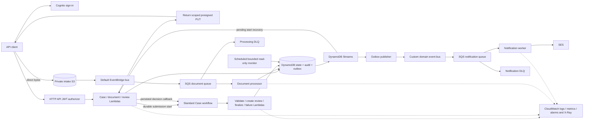

# Architecture and data flow

The backend uses Python 3.13, Lambda, an HTTP API with Cognito JWT authorization,
DynamoDB, private S3, EventBridge, SQS and Step Functions Standard. Terraform
describes infrastructure. React/TypeScript implements the separate local demo.

## Implemented backend topology

The diagram describes backend code, not currently running resources. The current
frontend does not call this API. CloudFront/static S3 hosting belongs to the
original target architecture, not a deployed frontend in this repository's evidence.

## One Case through the system

1. Creating a Case binds an immutable template version. Publishing a later version
   must not change existing Case checks.
2. The backend validates upload metadata and generates the object key. A signed
   PUT sends bytes directly to S3. A queue absorbs validation retries separately
   from request latency. Validation checks metadata, signatures and a streamed
   SHA-256 digest; it is not malware scanning or full document parsing.
3. Submit atomically persists business state, audit, event intent and durable replay
   data. Workflow start uses a deterministic Case/attempt identity; pending starts
   can be recovered without creating a new business attempt.
4. Standard Step Functions creates a task and waits for a backend-only callback.
   Claim/start/check/decision operations use current assignment and conditional
   transactional writes. A browser never receives a workflow task token.
5. A saved decision resumes the workflow. Finalization records approval, rejection
   or an information request with its original context. Technical workflow failure
   is distinct from a business rejection.
6. Resubmission creates a new attempt/task/checklist while preserving prior evidence.
   Outbox events feed independent notifications, so email failure does not roll
   back the Case decision.

## Storage contracts

| Purpose | Representation |
| --- | --- |
| Case aggregate | PK `CASE#{caseId}`; SK `CASE`, `DOC#{documentId}`, `TASK#{taskId}`, `CHECK#...`, `AUDIT#...`, `OUTBOX#...` |
| Immutable definitions | PK `TEMPLATE#{templateId}` with numeric version metadata/check items |
| Queue/list views | GSI1 and GSI2; reads recheck current authorization and state |
| Upload bytes | `cases/{caseId}/documents/{documentId}/v1/source`, generated by backend |
| Replays and consumer claims | Durable operation receipts and consumer-specific idempotency records |

Exact keys, states and access patterns remain in [technical design](../TECHNICAL_DESIGN.md),
[OpenAPI](../api/openapi.yaml) and [event schemas](../events). This guide does not
introduce new schema or grant requirements.
