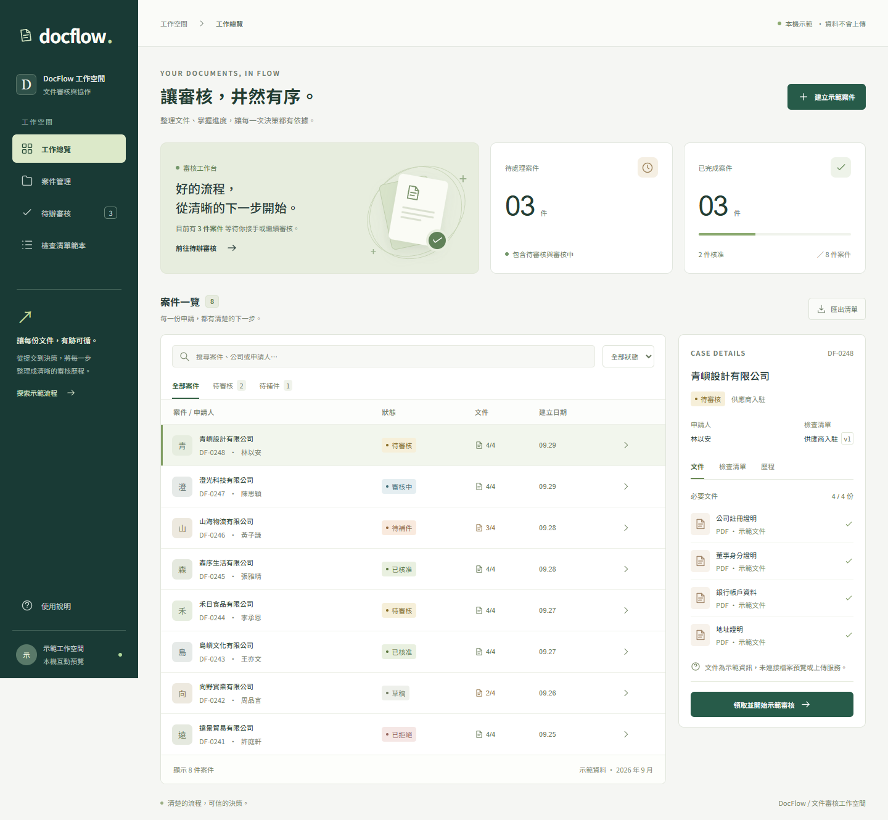
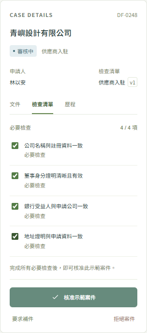
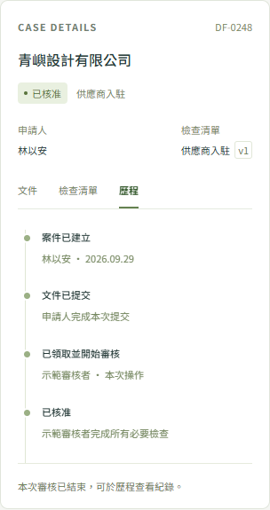
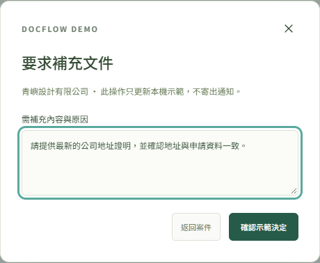
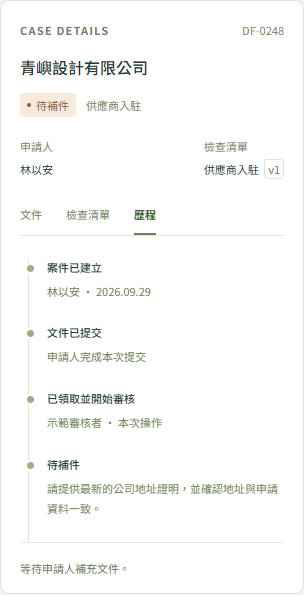
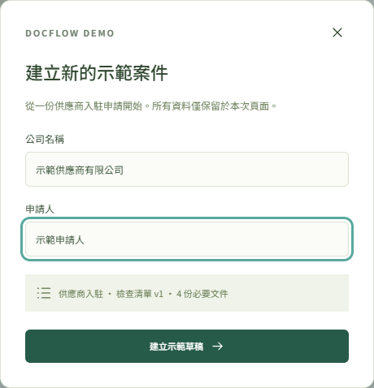

# DocFlow｜文件審核與協作平台

中文參考指南 · 2026-09-29 · Project 1

## 1. 這個專案有甚麼用？

DocFlow 把「收集文件、逐項檢查、人工決策、補件追蹤」整理成一個可追溯的案件流程。它的核心用途是讓團隊清楚知道：誰提交了甚麼、目前由誰審核、缺少哪些資料，以及為甚麼核准或拒絕。

目前以**供應商入駐**作為示範：申請人提供公司註冊證明、董事身分證明、銀行帳戶資料及地址證明；審核者依固定清單逐項檢查，作出核准、拒絕或要求補件的決定。這個模型也可作為員工入職、合約附件或報銷資料審核的開發起點；這些行業流程並未各自完成產品化，也不代表已取得 KYC 或合規認證。

| 常見問題 | DocFlow 的處理方式 |
| --- | --- |
| 文件散落在郵件與聊天中 | 以案件集中关联文件、要求、任務及歷程 |
| 不清楚審核進度 | 明確區分草稿、待審核、審核中、待補件及最終結果 |
| 不同人採用不同標準 | 案件綁定不可變的檢查清單版本 |
| 補件後看不見先前決定 | 新審核輪次保留舊任務、檢查結果及稽核紀錄 |
| 重試或多人操作造成重複處理 | 後端使用冪等紀錄、條件寫入與交易保護 |

**目前交付狀態：** 後端業務功能與基礎設施程式碼已實作；前端是可操作的記憶體示範，尚未串接真實登入、上傳或後端 API。部分真實 AWS 流程曾通過短期驗收，應用資源其後已清理。這是可供學習、展示及程式碼審查的作品，尚非可直接交付客戶的正式服務。

## 2. 誰會使用？

| 角色 | 後端實作的工作範圍 |
| --- | --- |
| 申請人 Requester | 建立及查看自己的案件，在允許狀態上傳文件、提交及補件重提 |
| 審核者 Reviewer | 查看審核佇列、領取任務、開始審核、填寫檢查结果及提交決定 |
| 管理員 Admin | 執行獲准的管理與查詢操作；修改審核內容仍須先領取任務 |
| 系統工作程序 | 驗證文件、推進工作流程、發送通知、記錄監控資料 |

展示頁使用固定的示範身份，並不是以上權限機制的實際登入畫面。

## 3. 具體實現了哪些功能？

| 功能 | 具體實現 | 前端演示範圍 |
| --- | --- | --- |
| 案件管理 | 建案、案件查詢、狀態轉移、擁有者權限檢查 | 建立示範草稿、案件列表、搜尋、狀態篩選 |
| 清單範本 | 不可變版本；案件綁定既定要求，後續版本不改動舊案 | 查看示範範本；無編輯或發布介面整合 |
| 私有文件上傳 | 後端產生 S3 路徑與受限簽名 PUT，文件內容不經 API 搬運 | 文件清單與資訊視窗；不實際上傳或預覽 PDF |
| 非同步文件驗證 | S3 事件進入 EventBridge/SQS；處理器檢查中繼資料、檔案特徵與 SHA-256 | 展示文件齊備程度；不模擬真實驗證引擎 |
| 提交與工作流程 | 提交檢查、持久冪等紀錄、Step Functions 人工審核等待與回呼 | 畫面由內建案件狀態開始演示 |
| 領取與逐項審核 | 交易式領取、指派檢查、樂觀版本保護；避免競爭領取 | 領取並開始、勾選必要項目、核准按鈕限制 |
| 三種審核結果 | 核准、拒絕、要求補件；後端保存決定並完成工作流程 | 三種決定及理由輸入；更新本頁狀態 |
| 補件與再次提交 | 可替換或新增文件，建立新輪次與新任務，保留舊歷程 | 顯示待補件與理由；尚無真實补件重提介面 |
| 稽核與事件 | 業務狀態、稽核與 outbox 在需要事件時以交易一併保存 | 案件歷程示範；不等於讀取真實稽核資料庫 |
| 郵件通知 | 審核就緒、核准、拒絕、補件四類事件；SES 工作程序與重試/DLQ | 不寄信；畫面操作僅改變本機狀態 |
| 可靠性與維運 | 消費者冪等、部分批次失敗、DLQ、待處理工作恢復、日誌/指標/告警 | 非前端產品功能；由後端測試與 IaC 文件說明 |
| 清單匯出 | 示範前端將目前篩選结果下載為 JSON | 僅匯出合成資料，不是正式報表服務 |

文件驗證不是防毒掃描、完整 PDF 解析或 AI 語意審核。Project 1 不使用 AI；OCR、RAG 及 AI 輔助只屬未來規劃。

## 4. 看圖理解操作流程

以下六張圖片均為 2026-09-29 從本機 React 頁面實際操作後截取，資料為程式內建的虛構示範。圖片保留原有中文介面，沒有加入不存在的產品功能。

### A. 工作總覽與案件定位



**圖 1｜**左側切換工作總覽、案件管理與待辦審核；中間搜尋及篩選案件；右側查看選中案件的文件、範本版本及狀態。上方數字是示範頁即時計算的本機資料，不是正式業務統計。

### B. 領取案件並完成檢查



**圖 2｜**選擇 DF-0248，按「領取並開始示範審核」，完成四項必要檢查後才能核准。真正的領取競爭、角色及指派保護在後端執行，不能只依賴按鈕是否可點。

### C. 核准後查看決策紀錄



**圖 3｜**確認核准後，案件狀態改變，歷程保留建立、提交、開始審核與核准等步驟。這張圖片是本機畫面结果，不是新的 AWS 驗收紀錄。

### D. 資料不足時要求補件



**圖 4｜**選擇「要求補件」，填寫缺少的資料與原因；例如要求最新地址證明。拒絕案件同樣需要理由，避免只留下無法解釋的狀態。



**圖 5｜**確認後顯示待補件，理由保存在示範歷程中。後端已實作補件重提及新輪次；這一段尚未接入前端上傳畫面。

### E. 建立新草稿



**圖 6｜**填寫公司與申請人即可建立本頁示範草稿。圖中表單尚未提交；提交後資料只存在當前頁面的記憶體，重新整理會重設。

## 5. 系統如何實現？

業務流程：建立案件 → 上傳文件 → 非同步驗證 → 提交 → 人工審核 → 核准／拒絕／要求補件 → 必要時補件重提。

| 技術層 | 實作與作用 |
| --- | --- |
| 展示介面 | React、TypeScript、Vite；目前獨立運行的示範 |
| 身份與 API | Cognito + API Gateway HTTP API；Python 3.13 Lambda 執行業務權限與命令 |
| 資料與文件 | DynamoDB 保存狀態、稽核與 outbox；私有 S3 保存文件 |
| 非同步處理 | EventBridge 路由事件，SQS 緩衝、重試及 DLQ 隔離失敗 |
| 審核協調 | Step Functions Standard 管理單一案件的工作流程；回呼 token 僅留在可信後端 |
| 通知與維運 | SES；CloudWatch 日誌、指標、告警、儀表板及原生 X-Ray |
| 基礎設施 | Terraform；部署需要另行授權，GitHub push 不會自動建立 AWS 資源 |

幾個值得參考的工程做法：不可變範本讓舊案標準不漂移；交易式 outbox 避免狀態已保存卻漏發事件；條件寫入避免兩人同時取得同一任務；補件使用新輪次而不是抹去舊歷程；郵件失敗不回滾業務決定。事件與郵件不承諾端到端「恰好一次」，不確定的 SES 接受結果仍可能導致重寄。

## 6. 已驗證到甚麼程度？

| 範圍 | 已有證據與限制 |
| --- | --- |
| 本機實作 | TASK-003 至 TASK-020 完成本機驗收；此文件工作不代表重新執行全部測試 |
| 真實 AWS | 2026-09-29 短期驗收通過核准、拒絕、替換文件重提、新增文件重提及無效文件拒絕五個流程 |
| 通知 | 12 筆完成紀錄證明 SES 接受及回執保存；不等於收件匣到達驗證 |
| 仍未完成 | 前端真實登入/API/上傳整合，以及更完整的瀏覽器、IAM、故障注入、競爭及保留期驗收 |
| 長時間測試 | 使用者省略 24 小時／14 天等長時間實測；省略不等於 PASS |
| 任務狀態 | TASK-021 維持 BLOCKED，剩餘驗收由使用者選擇跳過；TASK-022 文件已完成 |
| 雲端現況 | 應用資源與狀態桶已清理；兩份免費 SYSTEM 備份等待到期。沒有常駐後端服務 |

## 7. 如何自行演示？

從專案根目錄執行以下指令。需 Python 3.13、Node 22.12 以上的 22.x 版本；首次安裝需網路。

```powershell
py -3.13 scripts/dev.py bootstrap
py -3.13 scripts/dev.py dev
```

依 Vite 顯示的本機網址開啟頁面，通常為 `http://127.0.0.1:5173`。全套本機檢查另用 `py -3.13 scripts/dev.py check`。

建議五分鐘講解順序：總覽及篩選 → DF-0248 領取 → 勾選四項檢查並核准 → 重新整理 → 領取同案並要求補件 → 查看歷程 → 建立草稿及匯出 JSON。重新整理會清除演示修改；不需要 AWS 憑證，也不會寄送郵件。

本文件提供可離線開啟、內嵌圖片的 HTML 版本，適合分享給非技術讀者；Markdown 與原始 PNG 適合 GitHub 閱讀。既有線上预覽可能需要擁有者登入，不能當作所有讀者都能使用的公開服務。

## 8. 參考資料

- [GitHub 專案](https://github.com/chanbilly-lab/docflow)
- [架構與資料流](architecture.md)、[安全邊界](security.md)、[取捨](trade-offs.md)
- [五個真實 AWS 流程紀錄](../verification/TASK-021-20260929b-session.md)
- [完整驗收清單](../CLOUD_ACCEPTANCE.md)、[目前清理狀態](../verification/AWS-RETIREMENT.md)
- [英文版](guide-en.md)

讀者可將它作為事件驅動文件審核的工程參考；正式使用前仍須完成前後端整合、安全及容量驗證，並重新規劃獲准的部署。
